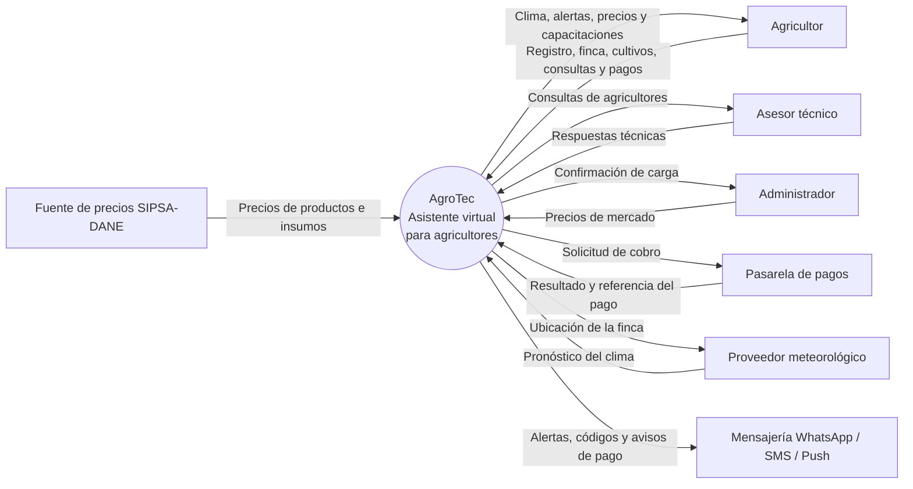

# Vista de contexto — ¿qué hace el sistema?

**Diapositiva 2.** Archivo en Visual Paradigm: `1 Vista de contexto - AgroTec` (tipo *Data Flow Diagram*). El diagrama de casos de uso quedó como respaldo.

## Qué debe tener
Es un **diagrama de contexto** (flujo de datos de nivel 0), como el ejemplo de la plantilla: **el sistema en un círculo central**, las entidades externas en rectángulos y **flechas con el nombre del dato** que entra o sale. No muestra pantallas, bases de datos ni módulos internos.

## Entidades y flujos

| Entidad | Tipo | Envía a AgroTec | Recibe de AgroTec |
|---|---|---|---|
| Agricultor | Persona | Registro, finca, cultivos, consultas y pagos | Clima, alertas, precios y capacitaciones |
| Asesor técnico | Persona | Respuestas técnicas | Consultas de agricultores |
| Administrador | Persona | Precios de mercado | Confirmación de carga |
| Pasarela de pagos | Sistema externo | Resultado y referencia del pago | Solicitud de cobro |
| Proveedor meteorológico | Sistema externo | Pronóstico del clima | Ubicación de la finca |
| Fuente de precios SIPSA-DANE | Sistema externo | Precios de productos e insumos | — |
| Mensajería WhatsApp / SMS / Push | Sistema externo | — | Alertas, códigos y avisos de pago |

> El proveedor del clima, la fuente de precios, la pasarela de pagos y la mensajería están **simulados** en el código (Open-Meteo es opcional). Dilo si te preguntan.

## Qué decir (30 segundos)
> «AgroTec es el sistema central. El agricultor le entrega sus datos de finca y cultivos y recibe clima, alertas y precios. El asesor responde consultas y el administrador carga precios. Hacia afuera, AgroTec pide el pronóstico a un proveedor meteorológico, recibe precios de SIPSA-DANE, cobra con una pasarela de pagos y envía avisos por mensajería.»

## Preguntas probables
- **¿Qué diferencia hay con un diagrama de casos de uso?** El de contexto muestra **qué datos** entran y salen del sistema; el de casos de uso muestra **qué funciones** usa cada actor.
- **¿Por qué la base de datos no aparece?** Es parte interna del sistema; el contexto solo muestra lo que está fuera.
- **¿Por qué la fuente de precios tiene una sola flecha?** El sistema solo recibe sus datos; no le envía nada.
- **¿Dónde se ve en el código?** Clima: `integration/weather`; pagos: `integration/payment`; mensajería: `integration/notification`; precios: `web/AdminController` (carga) y `config/DataSeeder` (datos de ejemplo).

## Diagrama de referencia (Mermaid)

