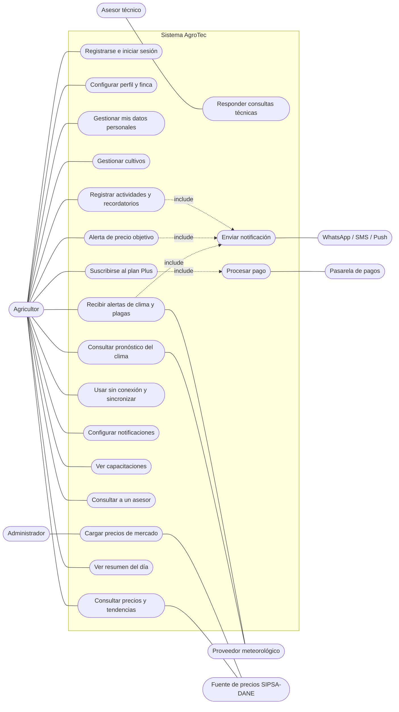

# Vista de contexto — ¿qué hace el sistema?

**Diapositiva 2.** Muestra el sistema como una caja negra: quién lo usa y con qué otros sistemas se comunica. Responde: *¿qué hace AgroTec y para quién?*

**Diagrama en Visual Paradigm:** *Use Case Diagram* (diagrama de casos de uso). Los sistemas externos se dibujan como actores secundarios, al lado derecho.

## Elementos para dibujar

### Actores (a la izquierda del sistema)

| Actor | Descripción |
|---|---|
| Agricultor | Usuario principal: pequeño o mediano productor de Nariño (persona: David Mateo Torres) |
| Asesor técnico | Responde las consultas de los agricultores con plan Plus |
| Administrador | Carga y actualiza los precios de mercado |

### Actores secundarios — sistemas externos (a la derecha)

| Sistema externo | Para qué se usa | En el código |
|---|---|---|
| Proveedor meteorológico | Pronóstico del clima (Open-Meteo; IDEAM como opción futura) | `WeatherProvider` |
| Fuente de precios (SIPSA-DANE) | Precios de productos e insumos | `PrecioService` (hoy datos de ejemplo) |
| Pasarela de pagos | Cobrar el plan Plus (Nequi, Daviplata, tarjeta, PSE) | `PaymentGateway` |
| Proveedor de WhatsApp / SMS / Push | Entregar las notificaciones | `NotificationChannel` |

### Casos de uso (dentro del límite del sistema «AgroTec»)

Agrupados por módulo. El código HU es el de las issues del repositorio.

| Módulo | Caso de uso | HU | Actor principal |
|---|---|---|---|
| 1. Usuarios y perfil | Registrarse | HU_001 | Agricultor |
| | Iniciar sesión y recuperar contraseña | HU_002 | Agricultor |
| | Configurar perfil y finca | HU_003 | Agricultor |
| | Gestionar mis datos personales | HU_004 | Agricultor |
| 2. Cultivos | Gestionar cultivos (crear, consultar, editar, eliminar) | HU_005, HU_006 | Agricultor |
| | Registrar actividades de un cultivo | HU_007 | Agricultor |
| | Recibir recordatorios de labores | HU_008 | Agricultor |
| 3. Clima y alertas | Consultar pronóstico del clima | HU_009 | Agricultor |
| | Recibir alertas climáticas | HU_010 | Agricultor |
| | Recibir alertas de plagas y enfermedades | HU_011 | Agricultor |
| 4. Precios | Consultar precios de insumos | HU_012 | Agricultor |
| | Consultar precios y tendencia de productos | HU_013 | Agricultor |
| | Configurar alerta de precio objetivo | HU_014 | Agricultor |
| 5. Conectividad | Usar la app sin conexión | HU_015 | Agricultor |
| | Sincronizar datos | HU_016 | Agricultor |
| | Ahorrar datos móviles | HU_017 | Agricultor |
| | Configurar notificaciones | HU_018 | Agricultor |
| 6. Capacitación, soporte y planes | Ver capacitaciones | HU_019 | Agricultor |
| | Consultar a un asesor técnico | HU_020 | Agricultor / Asesor |
| | Suscribirse al plan Plus | HU_021 | Agricultor |
| 7. Inicio y calidad | Ver resumen del día | HU_022 | Agricultor |
| Soporte (asesor) | Responder consultas técnicas | — | Asesor técnico |
| Administración | Cargar precios de mercado | — | Administrador |

> Las HU de calidad (interfaz simple, rendimiento, compatibilidad, confiabilidad de la información) son **requerimientos no funcionales**: no se dibujan como casos de uso, se mencionan en la presentación.

### Relaciones entre casos de uso

| Relación | Desde | Hacia |
|---|---|---|
| «include» | Recibir alertas climáticas, Recibir alertas de plagas, Recordatorios, Alerta de precio | Enviar notificación por el canal elegido |
| «include» | Suscribirse al plan Plus | Procesar pago |
| «include» | Consultar pronóstico, Recibir alertas climáticas | Obtener pronóstico del proveedor |
| «extend» | Usar la app sin conexión | (extiende) Gestionar cultivos y Registrar actividades |
| «include» | Casi todos los casos de uso | Iniciar sesión (no se dibuja para no saturar; se menciona) |

## Diagrama de referencia (Mermaid)

## Paso a paso en Visual Paradigm

1. Crea un diagrama nuevo de tipo **Use Case Diagram** y ponle el nombre «Vista de contexto - AgroTec».
2. Dibuja un rectángulo grande (**System / límite del sistema**) con el nombre «AgroTec».
3. Dentro, agrega los **casos de uso** (óvalos). Empieza por los 15 del agricultor; luego los 2 del asesor y administrador.
4. Fuera del rectángulo, a la izquierda, coloca los **actores** Agricultor, Asesor técnico y Administrador. A la derecha, los 4 sistemas externos (también como actores; si Visual Paradigm lo permite, márcalos como «system» con el estereotipo `<<sistema externo>>`).
5. Une cada actor con sus casos de uso mediante **asociaciones** (líneas simples).
6. Agrega las relaciones **«include»** (línea punteada con flecha hacia el caso incluido) de la tabla anterior.
7. Ordena para que no se crucen demasiadas líneas: agricultor a la izquierda, externos a la derecha, casos de uso en columnas por módulo.

## Qué decir en la presentación (30 segundos)

> «AgroTec ayuda al pequeño agricultor de Nariño a organizar sus cultivos, enterarse del clima y de las plagas antes de que lleguen, y conocer los precios para vender mejor, incluso con poca señal. El agricultor es el actor principal; el asesor responde consultas y el administrador carga precios. El sistema depende de cuatro servicios externos: clima, precios, pagos y mensajería.»
