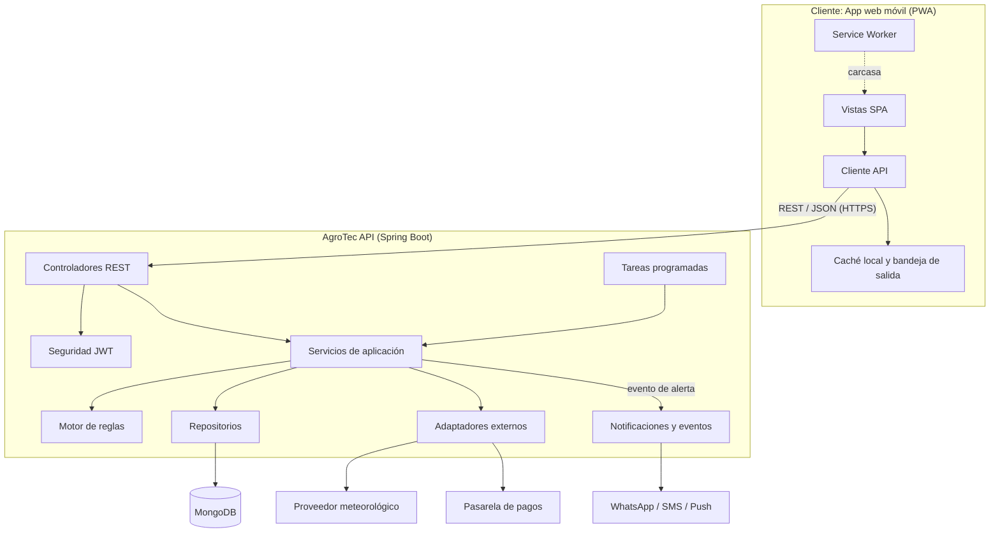

# Vista funcional — diagrama de componentes

**Diapositiva 3.** Muestra las **partes funcionales** del sistema (módulos desplegables y sus responsabilidades) y las **interfaces** con las que se comunican.

**Diagrama en Visual Paradigm:** *Component Diagram*.

## Componentes

### Cliente — «App web móvil (PWA)»

| Componente | Responsabilidad | Archivos |
|---|---|---|
| Vistas (SPA) | Pantallas: inicio, cultivos, clima, alertas, precios, perfil, etc. | `frontend/js/app.js` |
| Cliente API | Llamadas HTTP con el token JWT; caché de lecturas | `frontend/js/api.js` |
| Caché local y bandeja de salida | Guarda datos para uso sin conexión y los cambios pendientes de enviar | `localStorage` |
| Service Worker | Hace que la app abra sin conexión | `frontend/sw.js` |

### Backend — «AgroTec API (Spring Boot)»

| Componente | Responsabilidad | Paquete / clases |
|---|---|---|
| Controladores REST | Reciben las peticiones HTTP, validan y delegan | `web.*Controller` |
| Seguridad | Autenticación JWT y autorización por rol | `security.JwtAuthFilter`, `JwtService`, `config.SecurityConfig` |
| Servicios de aplicación | Lógica de negocio de cada módulo | `service.*Service` |
| Motor de reglas | Detecta heladas, lluvias, sequías y riesgo de plagas | `service.rules.ReglasClimaticas`, `ReglasPlagas` |
| Notificaciones y eventos | Envía alertas por push, WhatsApp o SMS | `event.*`, `integration.notification.*` |
| Tareas programadas | Recordatorios, revisión horaria de alertas, alertas de precio | `scheduler.TareasProgramadas` |
| Repositorios | Acceso a datos | `repository.*Repository` |
| Adaptadores externos | Clima y pagos detrás de interfaces | `integration.weather.*`, `integration.payment.*` |

### Datos y externos

| Componente | Tipo |
|---|---|
| MongoDB | Base de datos de documentos |
| Proveedor meteorológico (Open-Meteo) | Servicio externo |
| WhatsApp Business / SMS / Push (FCM) | Servicios externos |
| Pasarela de pagos | Servicio externo |

## Interfaces (lollipops)

| Interfaz | Tipo | Quién la ofrece | Quién la requiere |
|---|---|---|---|
| API REST (HTTPS/JSON) | Provista | Controladores REST | Cliente API |
| `WeatherProvider` | Provista y requerida | Adaptadores externos | Servicio de clima |
| `NotificationChannel` | Provista y requerida | Adaptadores externos | Notificaciones y eventos |
| `PaymentGateway` | Provista y requerida | Adaptadores externos | Servicio de suscripción |
| Repositorios Spring Data | Provista y requerida | Repositorios | Servicios de aplicación |

## Diagrama de referencia (Mermaid)

## Paso a paso en Visual Paradigm

1. Crea un **Component Diagram** nuevo: «Vista funcional - AgroTec».
2. Agrega dos componentes grandes: «App web móvil (PWA)» y «AgroTec API». Dentro de cada uno, anida los componentes de las tablas (en Visual Paradigm se arrastra un componente dentro de otro).
3. A la derecha, agrega los componentes externos y la base de datos (puedes usar el estereotipo `<<database>>` para MongoDB).
4. Dibuja las **interfaces**: usa el símbolo de interfaz provista (paleta) y de interfaz requerida (semicírculo) para `API REST`, `WeatherProvider`, `NotificationChannel` y `PaymentGateway`.
5. Conecta con **dependencias** (flecha punteada) los componentes que se usan.
6. Etiqueta las conexiones con el protocolo: «REST/JSON sobre HTTPS», «Driver MongoDB».

## Qué decir en la presentación (30 segundos)

> «Dividimos el sistema en una app web móvil y una API. La app guarda datos localmente para trabajar sin señal. En la API, los controladores atienden las peticiones, los servicios aplican la lógica y las reglas de alertas, y los repositorios hablan con MongoDB. Todo lo externo —clima, mensajería y pagos— está detrás de interfaces, de modo que podemos cambiar de proveedor sin tocar el resto.»
