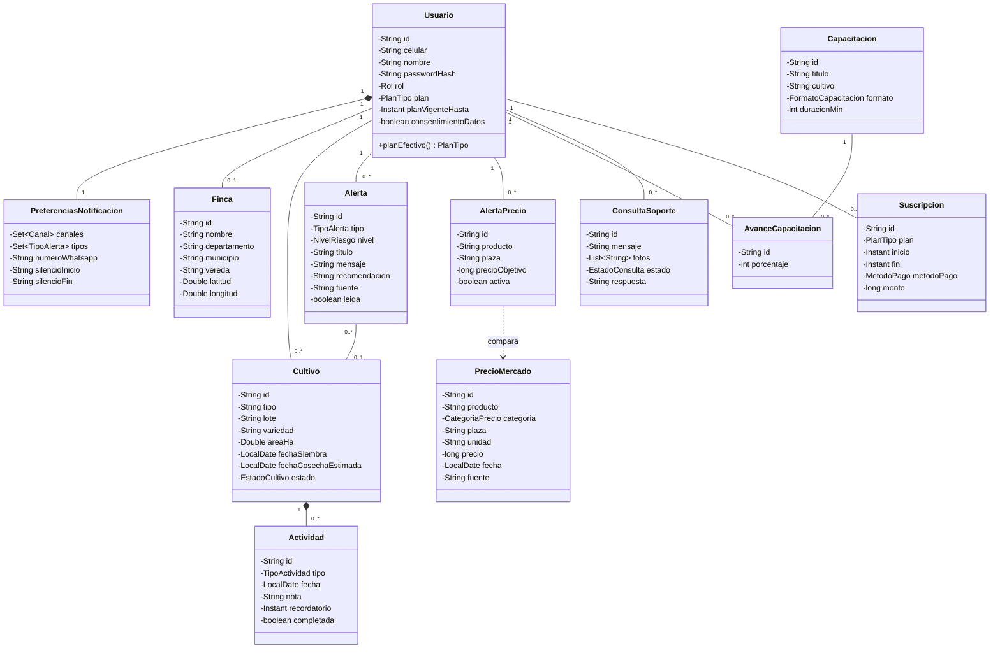

# Vista lógica — diagrama de clases del dominio

**Diapositiva 4.** Muestra el **modelo del dominio**: las clases del negocio, sus atributos y cómo se relacionan. No incluye capas técnicas (eso es la vista de desarrollo).

**Diagrama en Visual Paradigm:** *Class Diagram*.

## Clases y atributos

| Clase | Atributos principales | Colección MongoDB |
|---|---|---|
| **Usuario** | id, celular (único), nombre, passwordHash, rol, plan, planVigenteHasta, consentimientoDatos, consentimientoFecha, intentosFallidos, bloqueadoHasta | `usuarios` |
| **PreferenciasNotificacion** | canales, tipos, numeroWhatsapp, silencioInicio, silencioFin | embebida en `usuarios` |
| **Finca** | id, usuarioId, nombre, departamento, municipio, vereda, latitud, longitud | `fincas` |
| **Cultivo** | id, usuarioId, clienteId, tipo, lote, variedad, areaHa, fechaSiembra, fechaCosechaEstimada, estado, notas | `cultivos` |
| **Actividad** | id, usuarioId, cultivoId, tipo, fecha, nota, recordatorio, completada | `actividades` |
| **Alerta** | id, usuarioId, tipo, nivel, titulo, mensaje, recomendacion, cultivoId, fuente, clave, leida | `alertas` |
| **AlertaPrecio** | id, usuarioId, producto, plaza, precioObjetivo, activa | `alertas_precio` |
| **PrecioMercado** | id, producto, categoria, plaza, unidad, precio, fecha, fuente | `precios` |
| **Capacitacion** | id, titulo, descripcion, cultivo, formato, duracionMin, nivel, entidad | `capacitaciones` |
| **AvanceCapacitacion** | id, usuarioId, capacitacionId, porcentaje | `avances_capacitacion` |
| **ConsultaSoporte** | id, usuarioId, mensaje, fotos, estado, respuesta, asesorNombre | `consultas_soporte` |
| **Suscripcion** | id, usuarioId, plan, cancelada, inicio, fin, metodoPago, referenciaPago, monto | `suscripciones` |

### Enumeraciones

`Rol` (AGRICULTOR, ASESOR, ADMIN) · `PlanTipo` (GRATIS, PLUS) · `EstadoCultivo` (ACTIVO, COSECHADO) · `TipoActividad` (SIEMBRA, RIEGO, FERTILIZACION, CONTROL_PLAGAS, DESHIERBA, COSECHA, OTRA) · `TipoAlerta` (CLIMA, PLAGA, PRECIO, LABOR) · `NivelRiesgo` (BAJO, MEDIO, ALTO) · `Canal` (PUSH, WHATSAPP, SMS) · `CategoriaPrecio` (PRODUCTO, INSUMO) · `FormatoCapacitacion` (VIDEO, GUIA_PDF) · `EstadoConsulta` (ENVIADA, EN_REVISION, RESPONDIDA) · `MetodoPago` (NEQUI, DAVIPLATA, TARJETA, PSE)

## Relaciones y multiplicidades

| Relación | Tipo | Multiplicidad |
|---|---|---|
| Usuario — PreferenciasNotificacion | Composición (viven dentro del usuario) | 1 — 1 |
| Usuario — Finca | Asociación | 1 — 0..1 |
| Usuario — Cultivo | Asociación | 1 — 0..* |
| Cultivo — Actividad | Composición (sin cultivo no hay actividades) | 1 — 0..* |
| Usuario — Alerta | Asociación | 1 — 0..* |
| Alerta — Cultivo | Asociación opcional | 0..* — 0..1 |
| Usuario — AlertaPrecio | Asociación | 1 — 0..* |
| AlertaPrecio — PrecioMercado | Dependencia (se compara por producto y plaza) | — |
| Usuario — AvanceCapacitacion | Asociación | 1 — 0..* |
| Capacitacion — AvanceCapacitacion | Asociación | 1 — 0..* |
| Usuario — ConsultaSoporte | Asociación | 1 — 0..* |
| Usuario — Suscripcion | Asociación | 1 — 0..* |

## Diagrama de referencia (Mermaid)

## Paso a paso en Visual Paradigm

1. Crea un **Class Diagram**: «Vista lógica - AgroTec».
2. Crea las 12 clases. Para cada una escribe sus atributos (visibilidad `-` privado y tipo). Puedes omitir `id` si el diagrama queda muy cargado, pero déjalo en las clases principales.
3. Crea las enumeraciones (clase con estereotipo `<<enumeration>>`) solo para las que quieras destacar: `Rol`, `PlanTipo`, `TipoAlerta`, `Canal`. Las demás se pueden dejar como atributos tipados.
4. Dibuja las **asociaciones** con sus multiplicidades; las **composiciones** (rombo relleno) en Usuario→PreferenciasNotificacion y Cultivo→Actividad.
5. Coloca `Usuario` al centro: todo el modelo gira alrededor del agricultor.
6. Colorea por módulo (opcional): usuarios, cultivos, alertas, precios, capacitación/soporte/planes.

## Qué decir en la presentación (30 segundos)

> «El corazón del dominio es el Usuario. Tiene una finca y varios cultivos; cada cultivo guarda su historial de actividades. El sistema genera Alertas para el usuario, que se envían según sus preferencias. Los precios de mercado son independientes del usuario y el agricultor puede fijar alertas de precio objetivo. Además modelamos capacitaciones con su avance, consultas al asesor y suscripciones.»
