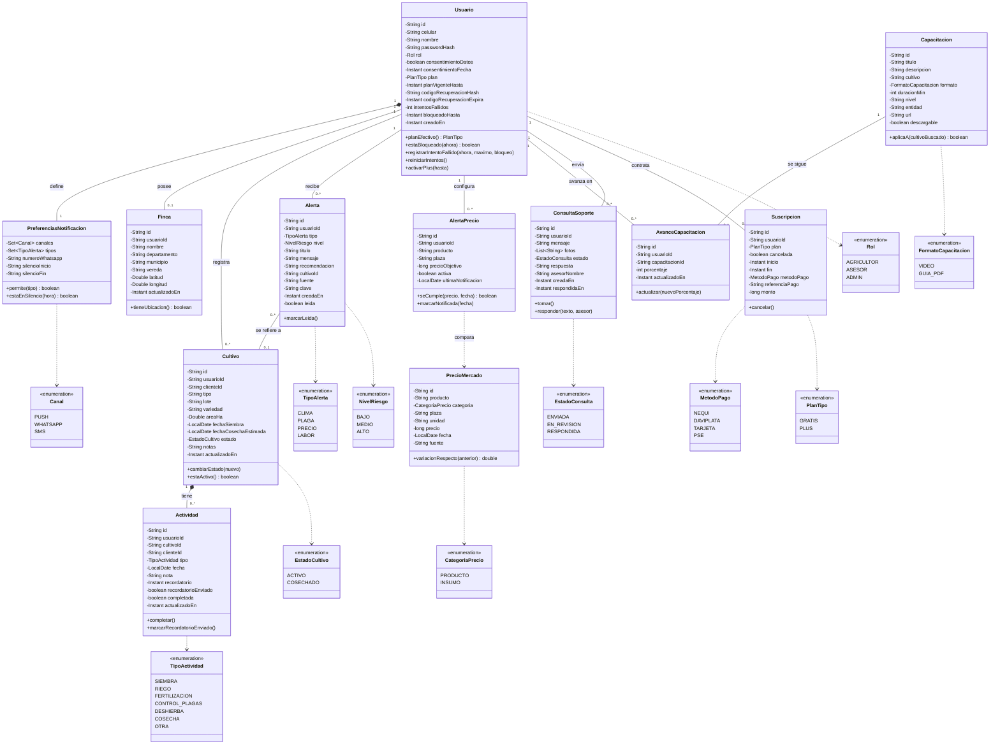

# Vista lógica — diagrama de clases del dominio

**Diapositiva 4.** Muestra las clases del negocio, sus atributos, métodos y relaciones. Archivo en Visual Paradigm: `3 Vista logica - AgroTec`.

## Qué debe tener
12 clases con atributos **y métodos**, 11 enumeraciones y 23 relaciones (12 entre clases y 11 dependencias hacia enumeraciones). Coincide uno a uno con `backend/src/main/java/com/agrotec/domain/`.

El atributo `preferencias` de `Usuario` no se escribe en la caja: se dibuja como la composición hacia `PreferenciasNotificacion`. La enumeración `Tendencia` (sube, baja, estable) no se dibuja: no se guarda, solo se calcula al responder la API de precios.

## Clases (atributos y métodos)

**Usuario**
```
-id: String
-celular: String
-nombre: String
-passwordHash: String
-rol: Rol
-consentimientoDatos: boolean
-consentimientoFecha: Instant
-plan: PlanTipo
-planVigenteHasta: Instant
-codigoRecuperacionHash: String
-codigoRecuperacionExpira: Instant
-intentosFallidos: int
-bloqueadoHasta: Instant
-creadoEn: Instant
--
+planEfectivo(): PlanTipo
+estaBloqueado(ahora): boolean
+registrarIntentoFallido(ahora, maximo, bloqueo)
+reiniciarIntentos()
+activarPlus(hasta)
```

**PreferenciasNotificacion**
```
-canales: Set<Canal>
-tipos: Set<TipoAlerta>
-numeroWhatsapp: String
-silencioInicio: String
-silencioFin: String
--
+permite(tipo): boolean
+estaEnSilencio(hora): boolean
```

**Finca**
```
-id: String
-usuarioId: String
-nombre: String
-departamento: String
-municipio: String
-vereda: String
-latitud: Double
-longitud: Double
-actualizadoEn: Instant
--
+tieneUbicacion(): boolean
```

**Cultivo**
```
-id: String
-usuarioId: String
-clienteId: String
-tipo: String
-lote: String
-variedad: String
-areaHa: Double
-fechaSiembra: LocalDate
-fechaCosechaEstimada: LocalDate
-estado: EstadoCultivo
-notas: String
-actualizadoEn: Instant
--
+cambiarEstado(nuevo)
+estaActivo(): boolean
```

**Actividad**
```
-id: String
-usuarioId: String
-cultivoId: String
-clienteId: String
-tipo: TipoActividad
-fecha: LocalDate
-nota: String
-recordatorio: Instant
-recordatorioEnviado: boolean
-completada: boolean
-actualizadoEn: Instant
--
+completar()
+marcarRecordatorioEnviado()
```

**Alerta**
```
-id: String
-usuarioId: String
-tipo: TipoAlerta
-nivel: NivelRiesgo
-titulo: String
-mensaje: String
-recomendacion: String
-cultivoId: String
-fuente: String
-clave: String
-creadaEn: Instant
-leida: boolean
--
+marcarLeida()
```

**AlertaPrecio**
```
-id: String
-usuarioId: String
-producto: String
-plaza: String
-precioObjetivo: long
-activa: boolean
-ultimaNotificacion: LocalDate
--
+seCumple(precio, fecha): boolean
+marcarNotificada(fecha)
```

**PrecioMercado**
```
-id: String
-producto: String
-categoria: CategoriaPrecio
-plaza: String
-unidad: String
-precio: long
-fecha: LocalDate
-fuente: String
--
+variacionRespecto(anterior): double
```

**Capacitacion**
```
-id: String
-titulo: String
-descripcion: String
-cultivo: String
-formato: FormatoCapacitacion
-duracionMin: int
-nivel: String
-entidad: String
-url: String
-descargable: boolean
--
+aplicaA(cultivoBuscado): boolean
```

**AvanceCapacitacion**
```
-id: String
-usuarioId: String
-capacitacionId: String
-porcentaje: int
-actualizadoEn: Instant
--
+actualizar(nuevoPorcentaje)
```

**ConsultaSoporte**
```
-id: String
-usuarioId: String
-mensaje: String
-fotos: List<String>
-estado: EstadoConsulta
-respuesta: String
-asesorNombre: String
-creadaEn: Instant
-respondidaEn: Instant
--
+tomar()
+responder(texto, asesor)
```

**Suscripcion**
```
-id: String
-usuarioId: String
-plan: PlanTipo
-cancelada: boolean
-inicio: Instant
-fin: Instant
-metodoPago: MetodoPago
-referenciaPago: String
-monto: long
--
+cancelar()
```

## Relaciones entre clases

| Desde | Hacia | Tipo | Multiplicidad | Nombre |
|---|---|---|---|---|
| Usuario | PreferenciasNotificacion | Composición | 1 — 1 | define |
| Usuario | Finca | Asociación | 1 — 0..1 | posee |
| Usuario | Cultivo | Asociación | 1 — 0..* | registra |
| Cultivo | Actividad | Composición | 1 — 0..* | tiene |
| Usuario | Alerta | Asociación | 1 — 0..* | recibe |
| Alerta | Cultivo | Asociación | 0..* — 0..1 | se refiere a |
| Usuario | AlertaPrecio | Asociación | 1 — 0..* | configura |
| AlertaPrecio | PrecioMercado | Dependencia | — | compara |
| Usuario | AvanceCapacitacion | Asociación | 1 — 0..* | avanza en |
| Capacitacion | AvanceCapacitacion | Asociación | 1 — 0..* | se sigue |
| Usuario | ConsultaSoporte | Asociación | 1 — 0..* | envía |
| Usuario | Suscripcion | Asociación | 1 — 0..* | contrata |

## Enumeraciones (con dependencia punteada desde su clase)

| Enumeración | Valores | Unida a |
|---|---|---|
| `Rol` | AGRICULTOR, ASESOR, ADMIN | Usuario |
| `Canal` | PUSH, WHATSAPP, SMS | PreferenciasNotificacion |
| `TipoAlerta` | CLIMA, PLAGA, PRECIO, LABOR | Alerta |
| `NivelRiesgo` | BAJO, MEDIO, ALTO | Alerta |
| `EstadoCultivo` | ACTIVO, COSECHADO | Cultivo |
| `TipoActividad` | SIEMBRA, RIEGO, FERTILIZACION, CONTROL_PLAGAS, DESHIERBA, COSECHA, OTRA | Actividad |
| `CategoriaPrecio` | PRODUCTO, INSUMO | PrecioMercado |
| `FormatoCapacitacion` | VIDEO, GUIA_PDF | Capacitacion |
| `EstadoConsulta` | ENVIADA, EN_REVISION, RESPONDIDA | ConsultaSoporte |
| `MetodoPago` | NEQUI, DAVIPLATA, TARJETA, PSE | Suscripcion |
| `PlanTipo` | GRATIS, PLUS | Suscripcion |

## Qué decir (30 segundos)
> «El corazón del dominio es el Usuario. Tiene una finca y registra cultivos; cada cultivo guarda sus actividades. El sistema le genera alertas, que se entregan según sus preferencias. Puede configurar alertas de precio que comparan contra los precios del mercado, seguir capacitaciones, consultar a un asesor y contratar el plan Plus. Cada clase tiene sus datos y las reglas que le corresponden.»

## Preguntas probables
- **¿Por qué Actividad es composición de Cultivo y Alerta no?** Si se borra el cultivo, sus actividades se borran con él. La alerta puede existir sin cultivo (una helada afecta a toda la finca).
- **¿Por qué las preferencias están dentro de Usuario?** Siempre se leen con el usuario y no crecen sin límite; en MongoDB se guardan en el mismo documento.
- **¿Por qué las entidades tienen métodos?** La lógica que pertenece a un objeto vive en ese objeto (`AlertaPrecio.seCumple`, `Usuario.estaBloqueado`) y no repartida en los servicios. Los servicios coordinan; las entidades deciden sobre sus propios datos.
- **¿Por qué no hay herencia?** Las diferencias entre tipos (alertas, roles) son de datos, no de comportamiento, así que se modelan con enumeraciones. La realización de interfaces aparece en la vista de desarrollo.
- **¿Por qué hay `usuarioId` además de la línea de asociación?** La línea es la relación conceptual; `usuarioId` es la forma en que MongoDB la guarda (referencia).

## Diagrama de referencia (Mermaid)


