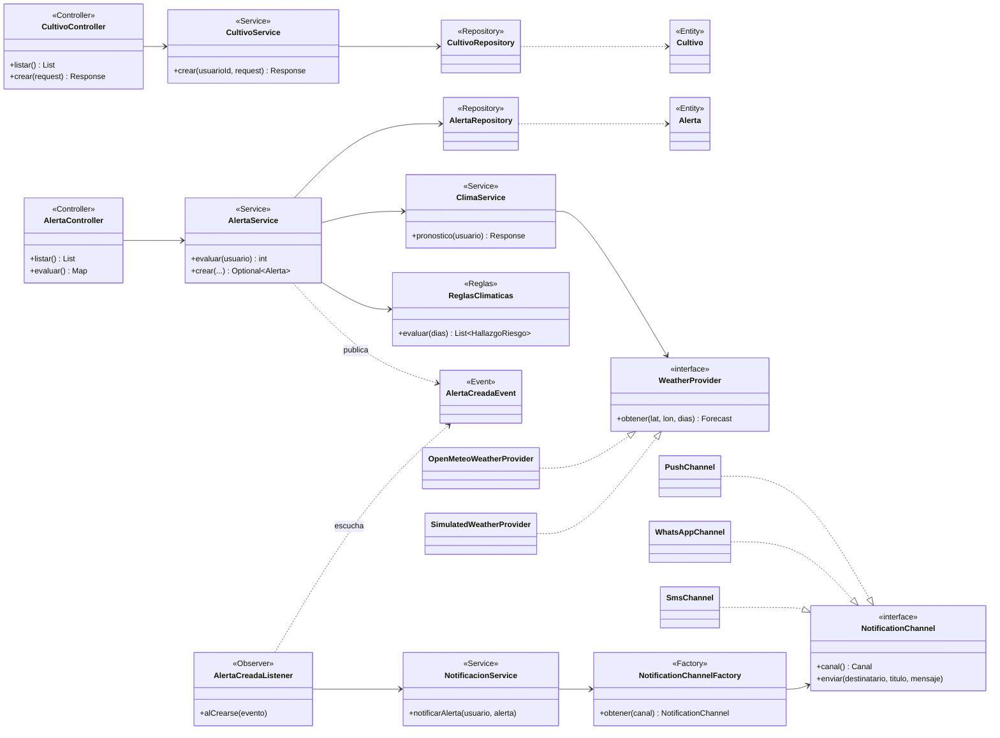

# Vista de desarrollo — clases por capas y patrones

**Diapositiva 5.** Muestra **cómo está organizado el código**: capas, paquetes, dependencias entre ellas y los **patrones de diseño y de arquitectura** aplicados.

**Diagrama en Visual Paradigm:** *Class Diagram* (con paquetes para las capas).

## Arquitectura: en capas (Layered Architecture)

```
┌──────────────────────────────────────────────┐
│  Presentación   web (controladores REST)     │  recibe HTTP, valida, delega
├──────────────────────────────────────────────┤
│  Aplicación     service (+ rules, event)     │  lógica de negocio y casos de uso
├──────────────────────────────────────────────┤
│  Dominio        domain                       │  entidades y reglas puras
├──────────────────────────────────────────────┤
│  Infraestructura repository, integration,    │  MongoDB, clima, pagos, mensajería,
│                 security, config, scheduler  │  JWT, tareas
└──────────────────────────────────────────────┘
   Transversales: dto, exception, util
```

**Regla de dependencia:** cada capa solo usa la de abajo. Los controladores nunca tocan repositorios; los servicios nunca conocen HTTP.

## Paquetes

| Capa | Paquete | Contenido |
|---|---|---|
| Presentación | `com.agrotec.web` | 16 controladores REST (`AuthController`, `CultivoController`, `ClimaController`, …) |
| Aplicación | `com.agrotec.service` | `AuthService`, `CultivoService`, `ActividadService`, `ClimaService`, `AlertaService`, `PrecioService`, `SyncService`, `NotificacionService`, `CapacitacionService`, `SoporteService`, `SuscripcionService`, `DatosPersonalesService`, `InicioService`, `RecordatorioService`, `PlanGuard`, `SyncMerge` |
| Aplicación | `com.agrotec.service.rules` | `ReglasClimaticas`, `ReglasPlagas`, `HallazgoRiesgo` |
| Aplicación | `com.agrotec.event` | `AlertaCreadaEvent`, `AlertaCreadaListener` |
| Dominio | `com.agrotec.domain` | 12 entidades y 11 enumeraciones |
| Infraestructura | `com.agrotec.repository` | 11 repositorios Spring Data MongoDB |
| Infraestructura | `com.agrotec.integration` | `weather` (Adapter), `notification` (Strategy + Factory), `payment` (Adapter) |
| Infraestructura | `com.agrotec.security` / `config` / `scheduler` | JWT, configuración de seguridad y OpenAPI, datos iniciales, tareas programadas |
| Transversal | `com.agrotec.dto` / `exception` / `util` | Contratos de la API, errores uniformes, utilidades |

## Patrones aplicados

| Patrón | Tipo | Dónde | Para qué |
|---|---|---|---|
| **Arquitectura en capas** | Arquitectura | Todo el backend | Separar responsabilidades y facilitar pruebas |
| **MVC / REST** | Arquitectura | `web` | Exponer la lógica como recursos HTTP |
| **Repository** | Diseño (acceso a datos) | `repository.*` | Ocultar MongoDB detrás de interfaces; los servicios no escriben consultas |
| **DTO** (Data Transfer Object) | Diseño | `dto.*` | No exponer las entidades (ni el `passwordHash`); controlar el contrato de la API |
| **Strategy** | Comportamiento | `NotificationChannel` → `PushChannel`, `WhatsAppChannel`, `SmsChannel` | Cada canal envía de forma distinta; el servicio los usa igual |
| **Factory** | Creación | `NotificationChannelFactory` | Elegir la estrategia según el `Canal` que escogió el usuario |
| **Adapter** | Estructural | `WeatherProvider` → `OpenMeteoWeatherProvider` / `SimulatedWeatherProvider`; `PaymentGateway` → `SimulatedPaymentGateway` | Aislar proveedores externos; cambiarlos sin tocar la lógica |
| **Observer** | Comportamiento | `AlertaCreadaEvent` + `AlertaCreadaListener` | Al crearse una alerta se notifica sin que `AlertaService` conozca las notificaciones |
| **Facade** | Estructural | `InicioService` | Una sola llamada arma el resumen combinando clima, alertas, cultivos y precios |
| **Inyección de dependencias / IoC** | Diseño | Todo Spring | Bajo acoplamiento; las clases reciben sus colaboradores por constructor |
| **Singleton** | Creación | Beans de Spring | Una sola instancia de cada servicio |
| **Chain of Responsibility (filtros)** | Comportamiento | `JwtAuthFilter` en la cadena de Spring Security | Autenticar antes de llegar al controlador |
| **Cache-aside** | Rendimiento | `ClimaService` (pronóstico 3 h) | Menos llamadas al proveedor y menos datos |

### Principios SOLID (cómo se ven en el código)

- **S**: cada servicio atiende un módulo (`CultivoService` solo cultivos).
- **O**: agregar un canal (correo) = una clase nueva; no se modifica `NotificacionService`.
- **L**: cualquier `NotificationChannel` o `WeatherProvider` puede sustituir a otro.
- **I**: interfaces pequeñas (`WeatherProvider` tiene un método).
- **D**: los servicios dependen de interfaces (`WeatherProvider`, `PaymentGateway`), no de clases concretas.

## Diagrama de referencia (Mermaid)



## Paso a paso en Visual Paradigm

1. Crea un **Class Diagram**: «Vista de desarrollo - AgroTec».
2. Agrega **4 paquetes** (Package) apilados de arriba hacia abajo: *Presentación (web)*, *Aplicación (service)*, *Dominio (domain)*, *Infraestructura (repository, integration)*. Dentro, las clases del diagrama de referencia.
3. Usa **estereotipos** en cada clase (`<<Controller>>`, `<<Service>>`, `<<Repository>>`, `<<Entity>>`, `<<interface>>`).
4. Dibuja **dependencias** hacia abajo (flecha punteada o asociación dirigida) y **realizaciones** (flecha punteada con triángulo vacío) de las implementaciones hacia sus interfaces.
5. Marca los patrones con **notas** (Note) pegadas a las clases: «Strategy», «Factory», «Adapter», «Observer», «Repository». Es lo que más puntúa en esta vista.
6. No dibujes todas las clases (son ~130): elige un recorrido completo, por ejemplo «crear alerta y notificar», que muestra cuatro patrones.

## Qué decir en la presentación (30 segundos)

> «Organizamos el backend en capas: controladores, servicios, dominio e infraestructura, con dependencias solo hacia abajo. Aplicamos Repository para el acceso a datos, DTO para el contrato de la API, Adapter para clima y pagos, Strategy y Factory para elegir cómo notificar, y Observer para que crear una alerta dispare la notificación sin acoplar los servicios.»
