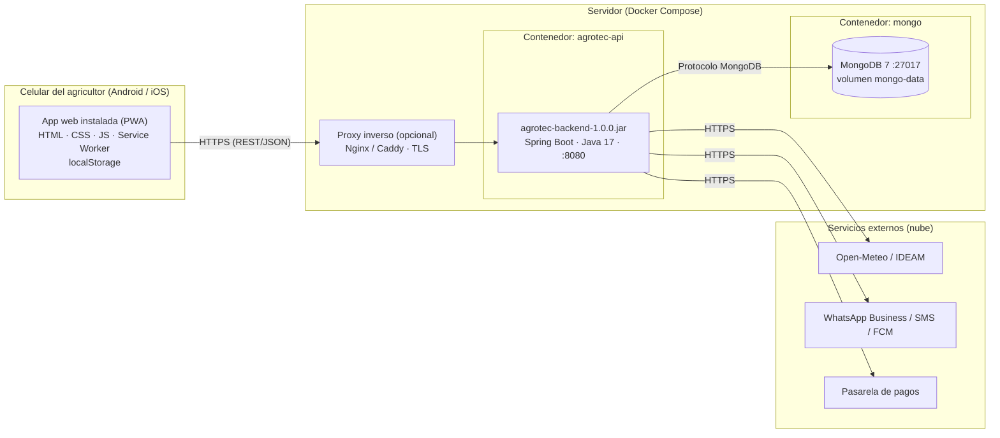

# Vista de despliegue

**Diapositiva 6.** Muestra **dónde corre cada parte del sistema**: dispositivos, servidores, contenedores, artefactos y conexiones.

**Diagrama en Visual Paradigm:** *Deployment Diagram*.

## Nodos y artefactos

| Nodo | Tipo | Contiene (artefactos) | Tecnología |
|---|---|---|---|
| Celular del agricultor | Dispositivo | App web instalada (PWA): HTML, CSS, JS, Service Worker, `localStorage` | Android 8+ / iOS 14+, navegador |
| Proxy inverso | Nodo de ejecución | Certificado TLS, redirección a la API | Nginx o Caddy (recomendado en producción) |
| Servidor de aplicación | Contenedor Docker | `agrotec-backend-1.0.0.jar` (API + frontend estático) | Java 17 (JRE), Spring Boot, puerto 8080 |
| Servidor de base de datos | Contenedor Docker | Base `agrotec` y volumen persistente `mongo-data` | MongoDB 7, puerto 27017 |
| Servicios externos | Nube | Clima, WhatsApp/SMS, pasarela de pagos | HTTPS |

Los dos contenedores se orquestan con **Docker Compose** (`docker-compose.yml`) en una red interna; solo el puerto de la API se publica.

## Conexiones

| Origen | Destino | Protocolo |
|---|---|---|
| Celular | Proxy / API | HTTPS (REST/JSON) |
| API | MongoDB | Protocolo MongoDB, red interna (puerto 27017) |
| API | Proveedor meteorológico | HTTPS |
| API | WhatsApp / SMS | HTTPS (API del proveedor) |
| API | Pasarela de pagos | HTTPS |

## Diagrama de referencia (Mermaid)

## Variantes que puedes mencionar

- **Producción económica:** una sola máquina virtual (por ejemplo, un VPS) con Docker Compose.
- **Producción administrada:** API en un servicio de contenedores y **MongoDB Atlas** como base de datos.
- **Escalado:** como la API no guarda sesión (JWT), se pueden levantar varias réplicas detrás de un balanceador. El caché de pronósticos (en memoria) pasaría a Redis.

## Paso a paso en Visual Paradigm

1. Crea un **Deployment Diagram**: «Vista de despliegue - AgroTec».
2. Agrega **nodos** (cubo 3D): «Celular del agricultor», «Servidor (Docker Compose)» y «Nube (servicios externos)».
3. Dentro del servidor, anida dos nodos con estereotipo `<<container>>`: «agrotec-api» y «mongo». Opcionalmente el proxy.
4. Coloca los **artefactos** (icono de documento) dentro de cada nodo: la PWA, `agrotec-backend-1.0.0.jar` y la base `agrotec`.
5. Une los nodos con **asociaciones** etiquetadas con el protocolo (HTTPS, MongoDB wire protocol) y, si quieres, el puerto.
6. Pon el **sistema operativo/tecnología** como propiedad o nota en cada nodo (Java 17, MongoDB 7, Android/iOS).

## Qué decir en la presentación (30 segundos)

> «El agricultor usa la app desde el navegador de su celular, instalable como PWA. Habla por HTTPS con la API de Spring Boot, que corre en un contenedor Docker junto a MongoDB. Con un solo comando (`docker compose up`) se levanta todo. La API llama a servicios externos de clima, mensajería y pagos. Como la API no guarda sesión, se puede escalar con varias réplicas.»
