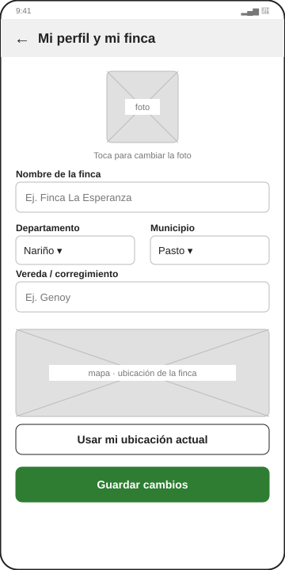
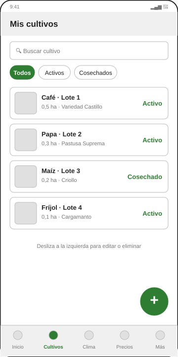
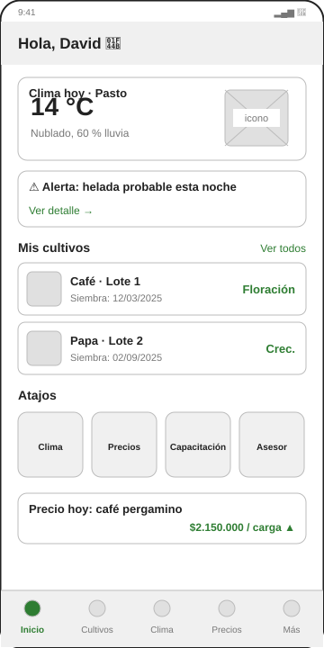

# Historias de usuario de AgroTec

26 historias de usuario; cada requerimiento tiene al menos una. Cada historia es también una issue de GitHub con su wireframe.

## Matriz de trazabilidad

| Requerimiento | Historias | Wireframes |
|---|---|---|
| RF-01 · Registro e inicio de sesión | HU_001, HU_002 | 01 |
| RF-02 · Perfil del agricultor y de la finca | HU_003 | 02 |
| RF-03 · Registro de cultivos | HU_005, HU_006 | 04, 05 |
| RF-04 · Actividades y recordatorios del cultivo | HU_007, HU_008 | 06 |
| RF-05 · Pronóstico del clima | HU_009 | 07 |
| RF-06 · Alertas climáticas | HU_010 | 08 |
| RF-07 · Alertas de plagas y enfermedades | HU_011 | 08 |
| RF-08 · Consulta de precios de insumos | HU_012 | 09 |
| RF-09 · Consulta de precios de productos agrícolas | HU_013, HU_014 | 09 |
| RF-10 · Funcionamiento sin conexión y sincronización | HU_015, HU_016 | 10 |
| RF-11 · Notificaciones por WhatsApp y SMS | HU_018 | 11 |
| RF-12 · Capacitaciones | HU_019 | 12 |
| RF-13 · Soporte técnico | HU_020 | 13 |
| RF-14 · Planes y suscripción | HU_021 | 14 |
| RF-15 · Panel de inicio | HU_022 | 03 |
| RNF-01 · Usabilidad para usuarios rurales | HU_023 | 03 |
| RNF-02 · Bajo consumo de datos | HU_017 | 10 |
| RNF-03 · Rendimiento | HU_024 | 03 |
| RNF-04 · Compatibilidad multiplataforma | HU_025 | 01 |
| RNF-05 · Seguridad y protección de datos personales | HU_004 | 02 |
| RNF-06 · Confiabilidad de la información | HU_026 | 07 |

## Módulo 1 · Gestión de usuarios y perfil

### HU_001 · Crear mi cuenta con el celular

#### Descripción
**Como**: agricultor nuevo  
**Quiero**: registrarme con mi nombre, número de celular y una contraseña o PIN  
**Para**: empezar a usar AgroTec sin trámites largos

**Requerimiento asociado**: RF-01 · Registro e inicio de sesión  
**Prioridad**: Alta

#### Criterios de aceptación

1. El formulario pide solo nombre, celular y contraseña/PIN de 4 dígitos.
2. Se valida que el celular tenga formato colombiano y no esté registrado.
3. Antes de crear la cuenta debo aceptar el tratamiento de datos personales.
4. Al terminar entro automáticamente al panel de inicio.

#### Wireframe

### HU_002 · Iniciar sesión y recuperar mi acceso

#### Descripción
**Como**: agricultor registrado  
**Quiero**: iniciar sesión con mi celular y recuperar mi contraseña por SMS  
**Para**: volver a mi información aunque olvide mis datos de acceso

**Requerimiento asociado**: RF-01 · Registro e inicio de sesión  
**Prioridad**: Alta

#### Criterios de aceptación

1. Puedo iniciar sesión con celular y contraseña/PIN.
2. «Recuperar contraseña» envía un código por SMS válido por 10 minutos.
3. Tras 5 intentos fallidos la cuenta se bloquea 15 minutos.
4. La sesión permanece abierta hasta que yo la cierre.

#### Wireframe

### HU_003 · Configurar mi perfil y la ubicación de mi finca

#### Descripción
**Como**: agricultor  
**Quiero**: registrar el nombre de mi finca, municipio, vereda y ubicación en el mapa  
**Para**: recibir clima, alertas y precios de mi zona

**Requerimiento asociado**: RF-02 · Perfil del agricultor y de la finca  
**Prioridad**: Alta

#### Criterios de aceptación

1. Puedo elegir departamento y municipio de listas.
2. Puedo usar la ubicación del GPS o marcarla en el mapa.
3. Si no hay conexión, los datos se guardan y se sincronizan luego.
4. Puedo editar estos datos en cualquier momento.

#### Wireframe

### HU_004 · Controlar mis datos personales

#### Descripción
**Como**: agricultor  
**Quiero**: dar mi consentimiento, y poder consultar, exportar y eliminar mis datos  
**Para**: confiar en que mi información está protegida

**Requerimiento asociado**: RNF-05 · Seguridad y protección de datos personales  
**Prioridad**: Alta

#### Criterios de aceptación

1. Se solicita consentimiento informado antes de recolectar datos.
2. Desde mi perfil puedo descargar y eliminar mis datos.
3. Los datos viajan y se guardan cifrados.
4. La política de tratamiento de datos es accesible desde la app en lenguaje sencillo.

#### Wireframe

## Módulo 2 · Gestión de cultivos

### HU_005 · Registrar un cultivo

#### Descripción
**Como**: agricultor  
**Quiero**: registrar un cultivo con su tipo, lote, variedad, área y fechas  
**Para**: tener organizado lo que tengo sembrado

**Requerimiento asociado**: RF-03 · Registro de cultivos  
**Prioridad**: Alta

#### Criterios de aceptación

1. Los campos obligatorios son tipo de cultivo, lote y fecha de siembra.
2. Puedo escoger el tipo de cultivo de una lista o escribir «Otro».
3. El cultivo guardado aparece en «Mis cultivos» y en el inicio.
4. Funciona sin conexión.

#### Wireframe

### HU_006 · Consultar, editar y eliminar mis cultivos

#### Descripción
**Como**: agricultor  
**Quiero**: ver la lista de mis cultivos y modificar o eliminar cualquiera  
**Para**: mantener actualizada la información de mi finca

**Requerimiento asociado**: RF-03 · Registro de cultivos  
**Prioridad**: Alta

#### Criterios de aceptación

1. La lista muestra tipo, lote, área y estado (activo/cosechado).
2. Puedo buscar y filtrar por estado.
3. Al eliminar se pide confirmación indicando que no se puede deshacer.
4. Puedo marcar un cultivo como cosechado.

#### Wireframe

### HU_007 · Registrar las actividades de un cultivo

#### Descripción
**Como**: agricultor  
**Quiero**: anotar riego, fertilización, control de plagas, deshierba y cosecha con su fecha  
**Para**: llevar el historial de mi cultivo y saber qué hice y cuándo

**Requerimiento asociado**: RF-04 · Actividades y recordatorios del cultivo  
**Prioridad**: Media

#### Criterios de aceptación

1. Puedo agregar una actividad con tipo, fecha y nota.
2. El historial se ordena de la más reciente a la más antigua.
3. Puedo editar o borrar una actividad registrada.
4. Funciona sin conexión.

#### Wireframe

### HU_008 · Recibir recordatorios de labores

#### Descripción
**Como**: agricultor  
**Quiero**: programar un recordatorio para una labor futura  
**Para**: no olvidar fertilizar, controlar plagas o cosechar a tiempo

**Requerimiento asociado**: RF-04 · Actividades y recordatorios del cultivo  
**Prioridad**: Media

#### Criterios de aceptación

1. Al crear una actividad futura puedo activar un recordatorio.
2. El recordatorio llega por el canal que elegí en mis notificaciones.
3. Puedo marcar la labor como hecha desde el recordatorio.
4. Los recordatorios funcionan aunque no haya conexión.

#### Wireframe

## Módulo 3 · Clima y alertas

### HU_009 · Ver el pronóstico del clima de mi finca

#### Descripción
**Como**: agricultor  
**Quiero**: ver el clima de hoy y de los próximos 7 días en mi ubicación  
**Para**: planificar siembra, riego y cosecha

**Requerimiento asociado**: RF-05 · Pronóstico del clima  
**Prioridad**: Alta

#### Criterios de aceptación

1. Se muestra temperatura mínima/máxima, probabilidad de lluvia, humedad y viento.
2. El pronóstico corresponde a la ubicación de mi finca.
3. Si no hay conexión veo el último pronóstico descargado con su hora de actualización.
4. Cada pronóstico indica su fuente.

#### Wireframe

### HU_010 · Recibir alertas climáticas

#### Descripción
**Como**: agricultor  
**Quiero**: recibir una alerta cuando haya riesgo de helada, lluvia intensa o sequía en mi zona  
**Para**: proteger mis cultivos y evitar pérdidas

**Requerimiento asociado**: RF-06 · Alertas climáticas  
**Prioridad**: Alta

#### Criterios de aceptación

1. La alerta indica evento, zona, horario y nivel de riesgo.
2. Incluye una recomendación breve de qué hacer.
3. Llega por el canal elegido (push, WhatsApp o SMS).
4. Queda guardada en la lista de alertas, también visible sin conexión.

#### Wireframe

### HU_011 · Recibir alertas de plagas y enfermedades

#### Descripción
**Como**: agricultor  
**Quiero**: recibir alertas de plagas y enfermedades propias de los cultivos que registré  
**Para**: actuar a tiempo y reducir pérdidas

**Requerimiento asociado**: RF-07 · Alertas de plagas y enfermedades  
**Prioridad**: Media

#### Criterios de aceptación

1. Solo recibo alertas de los tipos de cultivo que tengo registrados.
2. La alerta indica el cultivo afectado, nivel de riesgo y recomendación.
3. Puedo desactivar este tipo de alertas en mis preferencias.
4. La alerta enlaza a una capacitación o a contactar a un asesor.

#### Wireframe

## Módulo 4 · Precios de mercado

### HU_012 · Consultar precios de insumos

#### Descripción
**Como**: agricultor  
**Quiero**: consultar los precios de fertilizantes, semillas y agroquímicos de mi municipio  
**Para**: comprar mejor y comparar antes de gastar

**Requerimiento asociado**: RF-08 · Consulta de precios de insumos  
**Prioridad**: Media

#### Criterios de aceptación

1. Puedo buscar un insumo por nombre y filtrar por municipio/plaza.
2. Cada precio muestra unidad de venta y fecha de actualización.
3. Puedo ver los precios descargados sin conexión.
4. Se indica la fuente del dato.

#### Wireframe

### HU_013 · Consultar precios y tendencia de mis productos

#### Descripción
**Como**: agricultor  
**Quiero**: ver el precio actual de mis productos y cómo ha variado en los últimos 30 días  
**Para**: decidir cuándo y a quién vender para no depender solo de los intermediarios

**Requerimiento asociado**: RF-09 · Consulta de precios de productos agrícolas  
**Prioridad**: Media

#### Criterios de aceptación

1. Se muestra el precio por unidad con flecha de subida, bajada o sin cambio.
2. Hay un gráfico de tendencia de 30 días.
3. Puedo filtrar por plaza de mercado.
4. Se indica la fuente y la fecha de actualización.

#### Wireframe

### HU_014 · Configurar una alerta de precio objetivo

#### Descripción
**Como**: agricultor  
**Quiero**: definir un precio al que quiero vender mi producto y ser avisado cuando se alcance  
**Para**: vender en el mejor momento

**Requerimiento asociado**: RF-09 · Consulta de precios de productos agrícolas  
**Prioridad**: Baja

#### Criterios de aceptación

1. Puedo fijar un precio objetivo por producto y plaza.
2. Recibo una notificación cuando el precio lo alcanza o supera.
3. Puedo editar o eliminar la alerta.

#### Wireframe

## Módulo 5 · Conectividad y notificaciones

### HU_015 · Usar la aplicación sin conexión

#### Descripción
**Como**: agricultor en zona rural  
**Quiero**: consultar mis cultivos, el último pronóstico, alertas y precios sin internet  
**Para**: seguir trabajando aunque no tenga señal en mi finca

**Requerimiento asociado**: RF-10 · Funcionamiento sin conexión y sincronización  
**Prioridad**: Alta

#### Criterios de aceptación

1. Se muestra un aviso claro de «Sin conexión».
2. Veo los datos descargados con fecha y hora de la última actualización.
3. Puedo registrar cultivos y actividades sin conexión.
4. Ninguna pantalla principal falla o queda en blanco por falta de red.

#### Wireframe

### HU_016 · Sincronizar mis datos automáticamente

#### Descripción
**Como**: agricultor  
**Quiero**: que mis registros pendientes se envíen solos cuando vuelva la señal  
**Para**: no perder información ni repetir el trabajo

**Requerimiento asociado**: RF-10 · Funcionamiento sin conexión y sincronización  
**Prioridad**: Alta

#### Criterios de aceptación

1. Se muestra la lista de elementos pendientes por sincronizar.
2. La sincronización se inicia sola al detectar conexión.
3. Puedo forzar la sincronización con un botón.
4. Si hay conflicto de datos, se conserva el cambio más reciente y se me avisa.

#### Wireframe

### HU_017 · Ahorrar datos móviles

#### Descripción
**Como**: agricultor con plan de datos limitado  
**Quiero**: limitar la actualización a Wi-Fi y no descargar imágenes  
**Para**: no gastar mis datos ni mi saldo

**Requerimiento asociado**: RNF-02 · Bajo consumo de datos  
**Prioridad**: Alta

#### Criterios de aceptación

1. Existe la opción «Solo actualizar con Wi-Fi».
2. Existe la opción «No descargar imágenes».
3. El consumo normal diario no supera 5 MB (medido en pruebas).
4. Las actualizaciones descargan solo lo que cambió.

#### Wireframe

### HU_018 · Elegir cómo y cuándo recibir mis alertas

#### Descripción
**Como**: agricultor  
**Quiero**: elegir entre push, WhatsApp o SMS, los tipos de alerta y un horario silencioso  
**Para**: recibir la información por el medio que más uso y sin que me interrumpan de noche

**Requerimiento asociado**: RF-11 · Notificaciones por WhatsApp y SMS  
**Prioridad**: Media

#### Criterios de aceptación

1. Puedo activar o desactivar cada canal por separado.
2. Puedo activar o desactivar cada tipo de alerta.
3. Puedo definir un horario silencioso en el que no se envían notificaciones.
4. Para WhatsApp/SMS se confirma mi número antes de activarlo.

#### Wireframe

## Módulo 6 · Capacitación, soporte y suscripción

### HU_019 · Ver capacitaciones

#### Descripción
**Como**: agricultor  
**Quiero**: ver módulos de capacitación sobre el uso de la app y prácticas del campo  
**Para**: aprender a sacarle provecho a la tecnología y mejorar mi cultivo

**Requerimiento asociado**: RF-12 · Capacitaciones  
**Prioridad**: Media

#### Criterios de aceptación

1. Hay un módulo «Cómo usar AgroTec» visible desde el primer inicio.
2. Puedo filtrar capacitaciones por cultivo.
3. Cada módulo muestra duración, formato y mi porcentaje de avance.
4. Puedo descargar un módulo para verlo sin conexión.

#### Wireframe

### HU_020 · Consultar a un asesor técnico

#### Descripción
**Como**: agricultor  
**Quiero**: enviar una consulta con texto y fotos a un asesor y recibir su respuesta  
**Para**: resolver dudas sobre plagas, riego o fertilización sin desplazarme

**Requerimiento asociado**: RF-13 · Soporte técnico  
**Prioridad**: Media

#### Criterios de aceptación

1. Puedo escribir una consulta y adjuntar hasta 3 fotos.
2. Veo el estado de la consulta (enviada, en revisión, respondida).
3. La respuesta llega a la app y se notifica por mi canal elegido.
4. Hay un acceso directo para continuar la conversación por WhatsApp.

#### Wireframe

### HU_021 · Ver planes y suscribirme

#### Descripción
**Como**: agricultor  
**Quiero**: ver qué incluye el plan gratis y el plan de pago y suscribirme desde la app  
**Para**: acceder a más funciones por un costo que pueda pagar

**Requerimiento asociado**: RF-14 · Planes y suscripción  
**Prioridad**: Baja

#### Criterios de aceptación

1. Se comparan claramente ambos planes y su precio mensual en COP.
2. Puedo pagar con Nequi, Daviplata, tarjeta o PSE.
3. Puedo cancelar la suscripción en cualquier momento.
4. Recibo confirmación del pago por mi canal de notificaciones.

#### Wireframe

## Módulo 7 · Inicio y calidad de la experiencia

### HU_022 · Ver mi resumen del día en el inicio

#### Descripción
**Como**: agricultor  
**Quiero**: ver en una sola pantalla el clima, las alertas, mis cultivos y un precio de referencia  
**Para**: enterarme de lo importante de mi finca de un vistazo

**Requerimiento asociado**: RF-15 · Panel de inicio  
**Prioridad**: Media

#### Criterios de aceptación

1. El inicio muestra clima de hoy, alertas activas, resumen de cultivos y un precio.
2. Cada bloque lleva al detalle correspondiente con un toque.
3. Incluye atajos a Clima, Precios, Capacitación y Asesor.
4. Con datos locales carga en menos de 1 segundo.

#### Wireframe

### HU_023 · Usar una interfaz simple y legible

#### Descripción
**Como**: agricultor con poca experiencia digital  
**Quiero**: una app con textos grandes, iconos con nombre y pocos pasos  
**Para**: usarla sin ayuda y sin sentir que es difícil

**Requerimiento asociado**: RNF-01 · Usabilidad para usuarios rurales  
**Prioridad**: Alta

#### Criterios de aceptación

1. El texto base mide al menos 16 px y hay contraste suficiente.
2. Todo icono principal tiene una etiqueta de texto.
3. Cualquier función principal se alcanza en máximo 3 toques.
4. En pruebas con 5 usuarios, al menos 4 registran su primer cultivo sin ayuda en menos de 5 minutos.

#### Wireframe

### HU_024 · Que la app cargue rápido en mi celular

#### Descripción
**Como**: agricultor con un celular de gama baja  
**Quiero**: que las pantallas abran rápido y la app pese poco  
**Para**: no perder tiempo ni espacio en mi teléfono

**Requerimiento asociado**: RNF-03 · Rendimiento  
**Prioridad**: Media

#### Criterios de aceptación

1. Las pantallas principales cargan en menos de 3 s con 3G.
2. El instalador pesa menos de 50 MB.
3. La app funciona de forma fluida en un dispositivo Android con 2 GB de RAM.

#### Wireframe

### HU_025 · Instalar AgroTec en mi celular Android o iPhone

#### Descripción
**Como**: agricultor  
**Quiero**: descargar la app desde Google Play o App Store sin importar mi tipo de celular  
**Para**: poder usarla igual que cualquier otro agricultor

**Requerimiento asociado**: RNF-04 · Compatibilidad multiplataforma  
**Prioridad**: Alta

#### Criterios de aceptación

1. La app funciona en Android 8.0+ e iOS 14+.
2. La pantalla de registro y todas las pantallas se adaptan a distintos tamaños de pantalla.
3. La app está publicada en Google Play y en App Store.

#### Wireframe

### HU_026 · Saber de dónde viene la información

#### Descripción
**Como**: agricultor  
**Quiero**: ver la fuente y la fecha de cada dato de clima, alerta y precio  
**Para**: confiar en la información para tomar decisiones

**Requerimiento asociado**: RNF-06 · Confiabilidad de la información  
**Prioridad**: Alta

#### Criterios de aceptación

1. Cada pronóstico, alerta y precio muestra su fuente (p. ej. IDEAM, SIPSA-DANE).
2. Cada dato muestra su fecha y hora de actualización.
3. Los datos con más de 24 horas se marcan como «desactualizados».

#### Wireframe

