# Historias de usuario de AgroTec

26 historias de usuario; cada requerimiento tiene al menos una. Cada historia es también una issue de GitHub con su wireframe.

## Matriz de trazabilidad

| Requerimiento | Historias | Wireframes |
|---|---|---|
| RF-01 · Registro e inicio de sesión | HU-01, HU-02 | 01 |
| RF-02 · Perfil del agricultor y de la finca | HU-03 | 02 |
| RF-03 · Registro de cultivos | HU-04, HU-05 | 04, 05 |
| RF-04 · Actividades y recordatorios del cultivo | HU-06, HU-07 | 06 |
| RF-05 · Pronóstico del clima | HU-08 | 07 |
| RF-06 · Alertas climáticas | HU-09 | 08 |
| RF-07 · Alertas de plagas y enfermedades | HU-10 | 08 |
| RF-08 · Consulta de precios de insumos | HU-11 | 09 |
| RF-09 · Consulta de precios de productos agrícolas | HU-12, HU-13 | 09 |
| RF-10 · Funcionamiento sin conexión y sincronización | HU-14, HU-15 | 10 |
| RF-11 · Notificaciones por WhatsApp y SMS | HU-16 | 11 |
| RF-12 · Capacitaciones | HU-17 | 12 |
| RF-13 · Soporte técnico | HU-18 | 13 |
| RF-14 · Planes y suscripción | HU-19 | 14 |
| RF-15 · Panel de inicio | HU-20 | 03 |
| RNF-01 · Usabilidad para usuarios rurales | HU-21 | 03 |
| RNF-02 · Bajo consumo de datos | HU-22 | 10 |
| RNF-03 · Rendimiento | HU-23 | 03 |
| RNF-04 · Compatibilidad multiplataforma | HU-24 | 01 |
| RNF-05 · Seguridad y protección de datos personales | HU-25 | 02 |
| RNF-06 · Confiabilidad de la información | HU-26 | 07 |

## RF-01 · Registro e inicio de sesión

### HU-01 · Crear mi cuenta con el celular

**Como** agricultor nuevo, **quiero** registrarme con mi nombre, número de celular y una contraseña o PIN **para** empezar a usar AgroTec sin trámites largos.

**Requerimiento asociado:** RF-01 · Registro e inicio de sesión  
**Prioridad:** Alta

### Criterios de aceptación
- [ ] El formulario pide solo nombre, celular y contraseña/PIN de 4 dígitos.
- [ ] Se valida que el celular tenga formato colombiano y no esté registrado.
- [ ] Antes de crear la cuenta debo aceptar el tratamiento de datos personales.
- [ ] Al terminar entro automáticamente al panel de inicio.

### Mockup — Registro e inicio de sesión
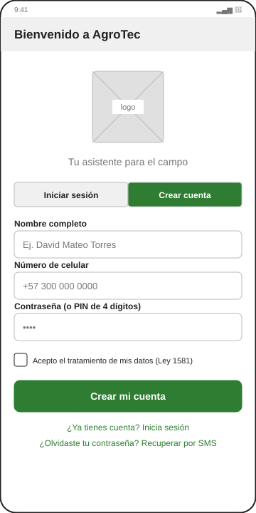

### HU-02 · Iniciar sesión y recuperar mi acceso

**Como** agricultor registrado, **quiero** iniciar sesión con mi celular y recuperar mi contraseña por SMS **para** volver a mi información aunque olvide mis datos de acceso.

**Requerimiento asociado:** RF-01 · Registro e inicio de sesión  
**Prioridad:** Alta

### Criterios de aceptación
- [ ] Puedo iniciar sesión con celular y contraseña/PIN.
- [ ] «Recuperar contraseña» envía un código por SMS válido por 10 minutos.
- [ ] Tras 5 intentos fallidos la cuenta se bloquea 15 minutos.
- [ ] La sesión permanece abierta hasta que yo la cierre.

### Mockup — Registro e inicio de sesión

## RF-02 · Perfil del agricultor y de la finca

### HU-03 · Configurar mi perfil y la ubicación de mi finca

**Como** agricultor, **quiero** registrar el nombre de mi finca, municipio, vereda y ubicación en el mapa **para** recibir clima, alertas y precios de mi zona.

**Requerimiento asociado:** RF-02 · Perfil del agricultor y de la finca  
**Prioridad:** Alta

### Criterios de aceptación
- [ ] Puedo elegir departamento y municipio de listas.
- [ ] Puedo usar la ubicación del GPS o marcarla en el mapa.
- [ ] Si no hay conexión, los datos se guardan y se sincronizan luego.
- [ ] Puedo editar estos datos en cualquier momento.

### Mockup — Perfil y finca

## RF-03 · Registro de cultivos

### HU-04 · Registrar un cultivo

**Como** agricultor, **quiero** registrar un cultivo con su tipo, lote, variedad, área y fechas **para** tener organizado lo que tengo sembrado.

**Requerimiento asociado:** RF-03 · Registro de cultivos  
**Prioridad:** Alta

### Criterios de aceptación
- [ ] Los campos obligatorios son tipo de cultivo, lote y fecha de siembra.
- [ ] Puedo escoger el tipo de cultivo de una lista o escribir «Otro».
- [ ] El cultivo guardado aparece en «Mis cultivos» y en el inicio.
- [ ] Funciona sin conexión.

### Mockup — Registrar cultivo
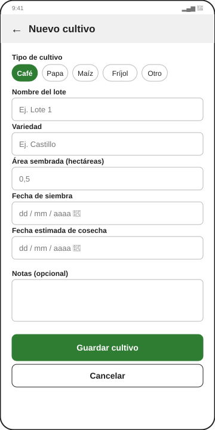

### HU-05 · Consultar, editar y eliminar mis cultivos

**Como** agricultor, **quiero** ver la lista de mis cultivos y modificar o eliminar cualquiera **para** mantener actualizada la información de mi finca.

**Requerimiento asociado:** RF-03 · Registro de cultivos  
**Prioridad:** Alta

### Criterios de aceptación
- [ ] La lista muestra tipo, lote, área y estado (activo/cosechado).
- [ ] Puedo buscar y filtrar por estado.
- [ ] Al eliminar se pide confirmación indicando que no se puede deshacer.
- [ ] Puedo marcar un cultivo como cosechado.

### Mockup — Mis cultivos

## RF-04 · Actividades y recordatorios del cultivo

### HU-06 · Registrar las actividades de un cultivo

**Como** agricultor, **quiero** anotar riego, fertilización, control de plagas, deshierba y cosecha con su fecha **para** llevar el historial de mi cultivo y saber qué hice y cuándo.

**Requerimiento asociado:** RF-04 · Actividades y recordatorios del cultivo  
**Prioridad:** Media

### Criterios de aceptación
- [ ] Puedo agregar una actividad con tipo, fecha y nota.
- [ ] El historial se ordena de la más reciente a la más antigua.
- [ ] Puedo editar o borrar una actividad registrada.
- [ ] Funciona sin conexión.

### Mockup — Actividades del cultivo
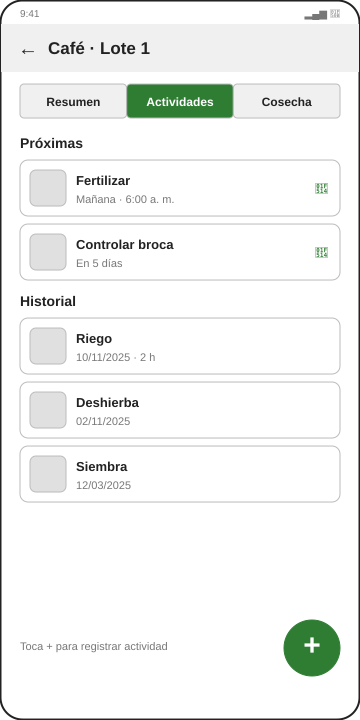

### HU-07 · Recibir recordatorios de labores

**Como** agricultor, **quiero** programar un recordatorio para una labor futura **para** no olvidar fertilizar, controlar plagas o cosechar a tiempo.

**Requerimiento asociado:** RF-04 · Actividades y recordatorios del cultivo  
**Prioridad:** Media

### Criterios de aceptación
- [ ] Al crear una actividad futura puedo activar un recordatorio.
- [ ] El recordatorio llega por el canal que elegí en mis notificaciones.
- [ ] Puedo marcar la labor como hecha desde el recordatorio.
- [ ] Los recordatorios funcionan aunque no haya conexión.

### Mockup — Actividades del cultivo

## RF-05 · Pronóstico del clima

### HU-08 · Ver el pronóstico del clima de mi finca

**Como** agricultor, **quiero** ver el clima de hoy y de los próximos 7 días en mi ubicación **para** planificar siembra, riego y cosecha.

**Requerimiento asociado:** RF-05 · Pronóstico del clima  
**Prioridad:** Alta

### Criterios de aceptación
- [ ] Se muestra temperatura mínima/máxima, probabilidad de lluvia, humedad y viento.
- [ ] El pronóstico corresponde a la ubicación de mi finca.
- [ ] Si no hay conexión veo el último pronóstico descargado con su hora de actualización.
- [ ] Cada pronóstico indica su fuente.

### Mockup — Pronóstico del clima
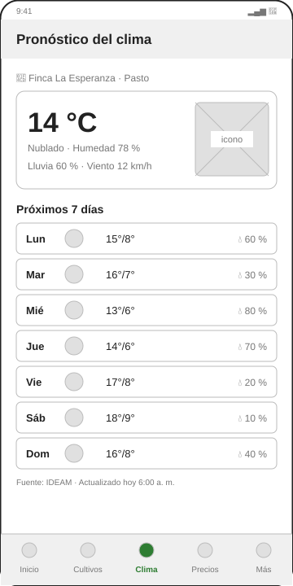

## RF-06 · Alertas climáticas

### HU-09 · Recibir alertas climáticas

**Como** agricultor, **quiero** recibir una alerta cuando haya riesgo de helada, lluvia intensa o sequía en mi zona **para** proteger mis cultivos y evitar pérdidas.

**Requerimiento asociado:** RF-06 · Alertas climáticas  
**Prioridad:** Alta

### Criterios de aceptación
- [ ] La alerta indica evento, zona, horario y nivel de riesgo.
- [ ] Incluye una recomendación breve de qué hacer.
- [ ] Llega por el canal elegido (push, WhatsApp o SMS).
- [ ] Queda guardada en la lista de alertas, también visible sin conexión.

### Mockup — Alertas de clima y plagas
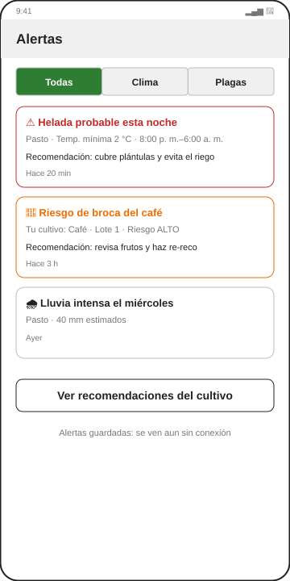

## RF-07 · Alertas de plagas y enfermedades

### HU-10 · Recibir alertas de plagas y enfermedades

**Como** agricultor, **quiero** recibir alertas de plagas y enfermedades propias de los cultivos que registré **para** actuar a tiempo y reducir pérdidas.

**Requerimiento asociado:** RF-07 · Alertas de plagas y enfermedades  
**Prioridad:** Media

### Criterios de aceptación
- [ ] Solo recibo alertas de los tipos de cultivo que tengo registrados.
- [ ] La alerta indica el cultivo afectado, nivel de riesgo y recomendación.
- [ ] Puedo desactivar este tipo de alertas en mis preferencias.
- [ ] La alerta enlaza a una capacitación o a contactar a un asesor.

### Mockup — Alertas de clima y plagas

## RF-08 · Consulta de precios de insumos

### HU-11 · Consultar precios de insumos

**Como** agricultor, **quiero** consultar los precios de fertilizantes, semillas y agroquímicos de mi municipio **para** comprar mejor y comparar antes de gastar.

**Requerimiento asociado:** RF-08 · Consulta de precios de insumos  
**Prioridad:** Media

### Criterios de aceptación
- [ ] Puedo buscar un insumo por nombre y filtrar por municipio/plaza.
- [ ] Cada precio muestra unidad de venta y fecha de actualización.
- [ ] Puedo ver los precios descargados sin conexión.
- [ ] Se indica la fuente del dato.

### Mockup — Precios del mercado
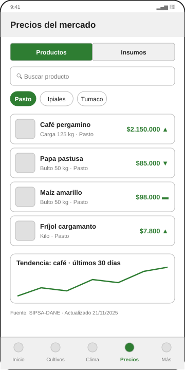

## RF-09 · Consulta de precios de productos agrícolas

### HU-12 · Consultar precios y tendencia de mis productos

**Como** agricultor, **quiero** ver el precio actual de mis productos y cómo ha variado en los últimos 30 días **para** decidir cuándo y a quién vender para no depender solo de los intermediarios.

**Requerimiento asociado:** RF-09 · Consulta de precios de productos agrícolas  
**Prioridad:** Media

### Criterios de aceptación
- [ ] Se muestra el precio por unidad con flecha de subida, bajada o sin cambio.
- [ ] Hay un gráfico de tendencia de 30 días.
- [ ] Puedo filtrar por plaza de mercado.
- [ ] Se indica la fuente y la fecha de actualización.

### Mockup — Precios del mercado

### HU-13 · Configurar una alerta de precio objetivo

**Como** agricultor, **quiero** definir un precio al que quiero vender mi producto y ser avisado cuando se alcance **para** vender en el mejor momento.

**Requerimiento asociado:** RF-09 · Consulta de precios de productos agrícolas  
**Prioridad:** Baja

### Criterios de aceptación
- [ ] Puedo fijar un precio objetivo por producto y plaza.
- [ ] Recibo una notificación cuando el precio lo alcanza o supera.
- [ ] Puedo editar o eliminar la alerta.

### Mockup — Precios del mercado

## RF-10 · Funcionamiento sin conexión y sincronización

### HU-14 · Usar la aplicación sin conexión

**Como** agricultor en zona rural, **quiero** consultar mis cultivos, el último pronóstico, alertas y precios sin internet **para** seguir trabajando aunque no tenga señal en mi finca.

**Requerimiento asociado:** RF-10 · Funcionamiento sin conexión y sincronización  
**Prioridad:** Alta

### Criterios de aceptación
- [ ] Se muestra un aviso claro de «Sin conexión».
- [ ] Veo los datos descargados con fecha y hora de la última actualización.
- [ ] Puedo registrar cultivos y actividades sin conexión.
- [ ] Ninguna pantalla principal falla o queda en blanco por falta de red.

### Mockup — Sin conexión y sincronización
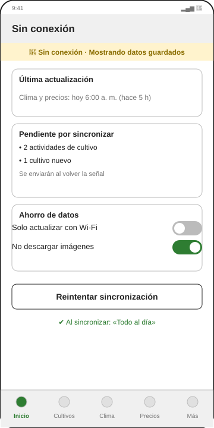

### HU-15 · Sincronizar mis datos automáticamente

**Como** agricultor, **quiero** que mis registros pendientes se envíen solos cuando vuelva la señal **para** no perder información ni repetir el trabajo.

**Requerimiento asociado:** RF-10 · Funcionamiento sin conexión y sincronización  
**Prioridad:** Alta

### Criterios de aceptación
- [ ] Se muestra la lista de elementos pendientes por sincronizar.
- [ ] La sincronización se inicia sola al detectar conexión.
- [ ] Puedo forzar la sincronización con un botón.
- [ ] Si hay conflicto de datos, se conserva el cambio más reciente y se me avisa.

### Mockup — Sin conexión y sincronización

## RF-11 · Notificaciones por WhatsApp y SMS

### HU-16 · Elegir cómo y cuándo recibir mis alertas

**Como** agricultor, **quiero** elegir entre push, WhatsApp o SMS, los tipos de alerta y un horario silencioso **para** recibir la información por el medio que más uso y sin que me interrumpan de noche.

**Requerimiento asociado:** RF-11 · Notificaciones por WhatsApp y SMS  
**Prioridad:** Media

### Criterios de aceptación
- [ ] Puedo activar o desactivar cada canal por separado.
- [ ] Puedo activar o desactivar cada tipo de alerta.
- [ ] Puedo definir un horario silencioso en el que no se envían notificaciones.
- [ ] Para WhatsApp/SMS se confirma mi número antes de activarlo.

### Mockup — Preferencias de notificaciones
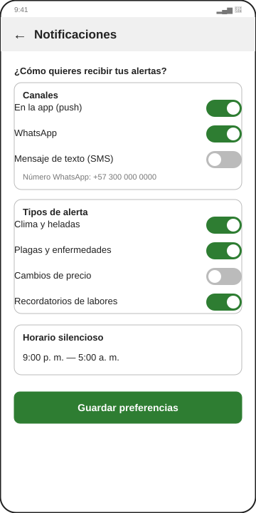

## RF-12 · Capacitaciones

### HU-17 · Ver capacitaciones

**Como** agricultor, **quiero** ver módulos de capacitación sobre el uso de la app y prácticas del campo **para** aprender a sacarle provecho a la tecnología y mejorar mi cultivo.

**Requerimiento asociado:** RF-12 · Capacitaciones  
**Prioridad:** Media

### Criterios de aceptación
- [ ] Hay un módulo «Cómo usar AgroTec» visible desde el primer inicio.
- [ ] Puedo filtrar capacitaciones por cultivo.
- [ ] Cada módulo muestra duración, formato y mi porcentaje de avance.
- [ ] Puedo descargar un módulo para verlo sin conexión.

### Mockup — Capacitaciones
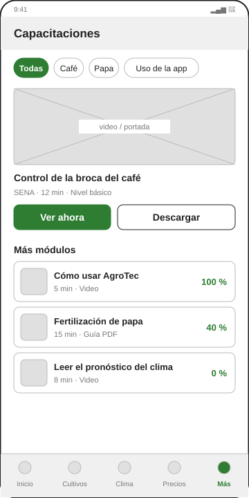

## RF-13 · Soporte técnico

### HU-18 · Consultar a un asesor técnico

**Como** agricultor, **quiero** enviar una consulta con texto y fotos a un asesor y recibir su respuesta **para** resolver dudas sobre plagas, riego o fertilización sin desplazarme.

**Requerimiento asociado:** RF-13 · Soporte técnico  
**Prioridad:** Media

### Criterios de aceptación
- [ ] Puedo escribir una consulta y adjuntar hasta 3 fotos.
- [ ] Veo el estado de la consulta (enviada, en revisión, respondida).
- [ ] La respuesta llega a la app y se notifica por mi canal elegido.
- [ ] Hay un acceso directo para continuar la conversación por WhatsApp.

### Mockup — Soporte técnico
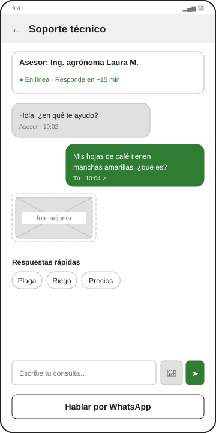

## RF-14 · Planes y suscripción

### HU-19 · Ver planes y suscribirme

**Como** agricultor, **quiero** ver qué incluye el plan gratis y el plan de pago y suscribirme desde la app **para** acceder a más funciones por un costo que pueda pagar.

**Requerimiento asociado:** RF-14 · Planes y suscripción  
**Prioridad:** Baja

### Criterios de aceptación
- [ ] Se comparan claramente ambos planes y su precio mensual en COP.
- [ ] Puedo pagar con Nequi, Daviplata, tarjeta o PSE.
- [ ] Puedo cancelar la suscripción en cualquier momento.
- [ ] Recibo confirmación del pago por mi canal de notificaciones.

### Mockup — Planes y suscripción
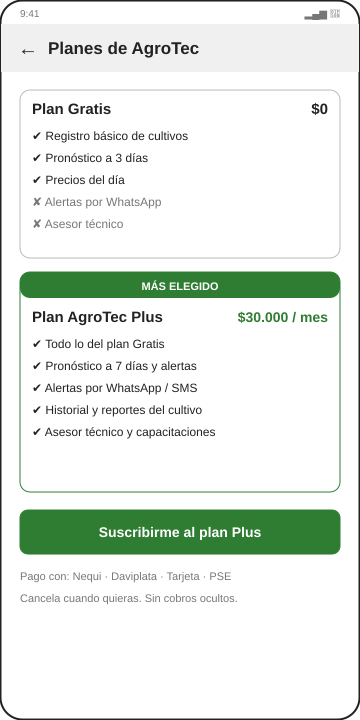

## RF-15 · Panel de inicio

### HU-20 · Ver mi resumen del día en el inicio

**Como** agricultor, **quiero** ver en una sola pantalla el clima, las alertas, mis cultivos y un precio de referencia **para** enterarme de lo importante de mi finca de un vistazo.

**Requerimiento asociado:** RF-15 · Panel de inicio  
**Prioridad:** Media

### Criterios de aceptación
- [ ] El inicio muestra clima de hoy, alertas activas, resumen de cultivos y un precio.
- [ ] Cada bloque lleva al detalle correspondiente con un toque.
- [ ] Incluye atajos a Clima, Precios, Capacitación y Asesor.
- [ ] Con datos locales carga en menos de 1 segundo.

### Mockup — Inicio

## RNF-01 · Usabilidad para usuarios rurales

### HU-21 · Usar una interfaz simple y legible

**Como** agricultor con poca experiencia digital, **quiero** una app con textos grandes, iconos con nombre y pocos pasos **para** usarla sin ayuda y sin sentir que es difícil.

**Requerimiento asociado:** RNF-01 · Usabilidad para usuarios rurales  
**Prioridad:** Alta

### Criterios de aceptación
- [ ] El texto base mide al menos 16 px y hay contraste suficiente.
- [ ] Todo icono principal tiene una etiqueta de texto.
- [ ] Cualquier función principal se alcanza en máximo 3 toques.
- [ ] En pruebas con 5 usuarios, al menos 4 registran su primer cultivo sin ayuda en menos de 5 minutos.

### Mockup — Inicio

## RNF-02 · Bajo consumo de datos

### HU-22 · Ahorrar datos móviles

**Como** agricultor con plan de datos limitado, **quiero** limitar la actualización a Wi-Fi y no descargar imágenes **para** no gastar mis datos ni mi saldo.

**Requerimiento asociado:** RNF-02 · Bajo consumo de datos  
**Prioridad:** Alta

### Criterios de aceptación
- [ ] Existe la opción «Solo actualizar con Wi-Fi».
- [ ] Existe la opción «No descargar imágenes».
- [ ] El consumo normal diario no supera 5 MB (medido en pruebas).
- [ ] Las actualizaciones descargan solo lo que cambió.

### Mockup — Sin conexión y sincronización

## RNF-03 · Rendimiento

### HU-23 · Que la app cargue rápido en mi celular

**Como** agricultor con un celular de gama baja, **quiero** que las pantallas abran rápido y la app pese poco **para** no perder tiempo ni espacio en mi teléfono.

**Requerimiento asociado:** RNF-03 · Rendimiento  
**Prioridad:** Media

### Criterios de aceptación
- [ ] Las pantallas principales cargan en menos de 3 s con 3G.
- [ ] El instalador pesa menos de 50 MB.
- [ ] La app funciona de forma fluida en un dispositivo Android con 2 GB de RAM.

### Mockup — Inicio

## RNF-04 · Compatibilidad multiplataforma

### HU-24 · Instalar AgroTec en mi celular Android o iPhone

**Como** agricultor, **quiero** descargar la app desde Google Play o App Store sin importar mi tipo de celular **para** poder usarla igual que cualquier otro agricultor.

**Requerimiento asociado:** RNF-04 · Compatibilidad multiplataforma  
**Prioridad:** Alta

### Criterios de aceptación
- [ ] La app funciona en Android 8.0+ e iOS 14+.
- [ ] La pantalla de registro y todas las pantallas se adaptan a distintos tamaños de pantalla.
- [ ] La app está publicada en Google Play y en App Store.

### Mockup — Registro e inicio de sesión

## RNF-05 · Seguridad y protección de datos personales

### HU-25 · Controlar mis datos personales

**Como** agricultor, **quiero** dar mi consentimiento, y poder consultar, exportar y eliminar mis datos **para** confiar en que mi información está protegida.

**Requerimiento asociado:** RNF-05 · Seguridad y protección de datos personales  
**Prioridad:** Alta

### Criterios de aceptación
- [ ] Se solicita consentimiento informado antes de recolectar datos.
- [ ] Desde mi perfil puedo descargar y eliminar mis datos.
- [ ] Los datos viajan y se guardan cifrados.
- [ ] La política de tratamiento de datos es accesible desde la app en lenguaje sencillo.

### Mockup — Perfil y finca

## RNF-06 · Confiabilidad de la información

### HU-26 · Saber de dónde viene la información

**Como** agricultor, **quiero** ver la fuente y la fecha de cada dato de clima, alerta y precio **para** confiar en la información para tomar decisiones.

**Requerimiento asociado:** RNF-06 · Confiabilidad de la información  
**Prioridad:** Alta

### Criterios de aceptación
- [ ] Cada pronóstico, alerta y precio muestra su fuente (p. ej. IDEAM, SIPSA-DANE).
- [ ] Cada dato muestra su fecha y hora de actualización.
- [ ] Los datos con más de 24 horas se marcan como «desactualizados».

### Mockup — Pronóstico del clima

