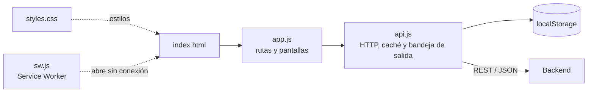
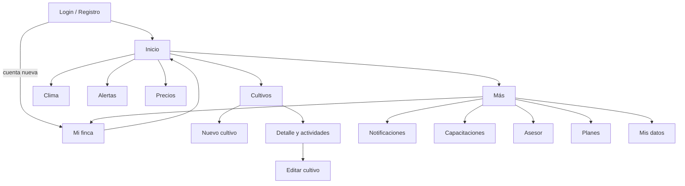

# Guía de sustentación de AgroTec

Léela en este orden. No memorices: **abre cada archivo en VS Code mientras lees**.

| Bloque | Tema | Tiempo |
|---|---|---|
| 1 | El proyecto en un minuto | 10 min |
| 2 | Cómo está organizado el código | 20 min |
| 3 | El recorrido de una petición | 40 min |
| 4 | ¿Dónde está cada cosa? | 40 min |
| 5 | Postman ([guía](guia-postman.md)) | 45 min |
| 6 | Modificar código ([ejercicios](ejercicios.md)) | 1,5 h |
| 7 | Frontend | 30 min |
| 8 | Diagramas ([guía](../arquitectura/guia-completa-diagramas.md)) y [preguntas](../arquitectura/preguntas-profesor.md) | 1 h |
| 9 | Ensayo y día de la exposición | 30 min |

## 1. El proyecto en un minuto

> «AgroTec es un asistente para pequeños agricultores de Nariño. Permite organizar cultivos, recibir alertas de clima y plagas, consultar precios y pedir asesoría, incluso con poca señal. El backend es Java con Spring Boot y MongoDB, organizado en capas, con patrones como Repository, Adapter, Strategy, Factory y Observer. Tiene además una app web móvil. El clima, los precios, la mensajería y los pagos están simulados detrás de interfaces.»

## 2. Cómo está organizado el código

Todo el backend está en `backend/src/main/java/com/agrotec/`.

| Carpeta | Qué hay | Cómo explicarlo |
|---|---|---|
| `web` | Controladores | «La puerta de entrada: reciben la petición HTTP» |
| `dto` | Datos que entran y salen | «El contrato de la API; aquí se valida» |
| `service` | Lógica de negocio | «Coordinan cada caso de uso» |
| `service/rules` | Reglas de alertas | «Deciden si hay riesgo» |
| `domain` | Entidades y enumeraciones | «Los objetos del negocio y sus reglas» |
| `repository` | Acceso a MongoDB | «Spring genera las consultas por el nombre del método» |
| `integration` | Clima, mensajería, pagos | «Lo externo, detrás de interfaces» |
| `security`, `config` | JWT y configuración | «Quién entra y cómo arranca» |
| `event`, `scheduler` | Eventos y tareas automáticas | «Reaccionar y revisar cada cierto tiempo» |
| `exception`, `util` | Errores y utilidades | «Apoyo común» |

**En VS Code:** `Ctrl+P` abre un archivo por nombre; `Ctrl+Shift+F` busca texto en todo el proyecto; `Ctrl+clic` va a la definición; `F12` también.

## 3. El recorrido de una petición: registrar un cultivo

`Pantalla → Controlador → DTO (valida) → Servicio → Repositorio → MongoDB`

**Paso 0. Antes de llegar al controlador**, `JwtAuthFilter` lee el token y deja identificado al usuario.

**Paso 1. Controlador** (`web/CultivoController.java`)

```java
    @PostMapping
    public ResponseEntity<CultivoDto.Response> crear(@AuthenticationPrincipal AuthUser user,
                                                     @Valid @RequestBody CultivoDto.Request r) {
        return ResponseEntity.status(HttpStatus.CREATED).body(cultivos.crear(user.id(), r));
    }
```

- `@PostMapping`: responde a `POST /api/cultivos` (la ruta base está arriba de la clase).
- `@Valid`: revisa las reglas del DTO; si falla, responde 400 sin entrar al método.
- `@RequestBody`: convierte el JSON en un objeto Java.
- `@AuthenticationPrincipal`: el usuario sacado del token. Por eso nadie puede crear cultivos a nombre de otro.
- Devuelve **201** (creado).

**Paso 2. Servicio** (`service/CultivoService.java`)

```java
    public CultivoDto.Response crear(String usuarioId, CultivoDto.Request r) {
        // Idempotencia: si el celular reintenta un alta hecha sin conexión, no se duplica.
        if (r.clienteId() != null && !r.clienteId().isBlank()) {
            var existente = cultivos.findByUsuarioIdAndClienteId(usuarioId, r.clienteId());
            if (existente.isPresent()) {
                return CultivoDto.Response.de(existente.get());
            }
        }
        Cultivo c = new Cultivo();
        c.setUsuarioId(usuarioId);
        c.setClienteId(r.clienteId());
        aplicar(c, r);
        return CultivoDto.Response.de(cultivos.save(c));
    }
```

- Si el celular reintenta un envío hecho sin conexión (`clienteId`), devuelve el existente y no duplica.
- Crea la entidad, le asigna el dueño, copia los datos y la guarda.

**Paso 3. Repositorio** (`repository/CultivoRepository.java`): es una interfaz; **no tiene código**. Spring Data crea la implementación y deduce la consulta del nombre (`findByUsuarioIdAndClienteId` = buscar por usuario y por clienteId).

**Si entiendes este recorrido, entiendes todos los módulos:** cambia «Cultivo» por «Alerta», «Precio» o «Soporte».

### Anotaciones que te pueden preguntar

| Anotación | Significa |
|---|---|
| `@SpringBootApplication` | Punto de arranque y autoconfiguración |
| `@RestController` | Clase que atiende peticiones y responde JSON |
| `@RequestMapping`, `@GetMapping`, `@PostMapping`, `@PutMapping`, `@PatchMapping`, `@DeleteMapping` | Ruta y método HTTP |
| `@Service` | Clase de lógica de negocio que Spring administra |
| `@Component` | Objeto administrado por Spring (bean) |
| `@Configuration` y `@Bean` | Configuración y objetos creados a mano |
| `@Document` / `@Id` / `@Indexed` | Colección de MongoDB, identificador e índice |
| `@NotBlank`, `@NotNull`, `@Positive`, `@Size`, `@Pattern` | Validaciones |
| `@EventListener` | Reacciona a un evento (Observer) |
| `@Scheduled` | Se ejecuta sola cada cierto tiempo |
| `@Value` | Lee un valor de `application.yml` |
| `@RestControllerAdvice` | Manejo central de errores |

**Inyección de dependencias:** las clases reciben lo que necesitan por el **constructor** y Spring lo entrega. Nunca verás `new CultivoService(...)`.

### Códigos de respuesta

200 bien · 201 creado · 204 bien sin contenido · 400 datos inválidos · 401 sin sesión · 403 sin permiso o sin plan · 404 no existe · 409 ya existe · 500 error inesperado.

## 4. ¿Dónde está cada cosa?

Practica así: tapa las dos columnas de la derecha, lee la pregunta y encuéntrala en VS Code.

| Si preguntan… | Archivo | Busca |
|---|---|---|
| ¿Dónde arranca la aplicación? | `AgroTecApplication.java` | `main` |
| ¿Dónde se configura la conexión a MongoDB y el puerto? | `backend/src/main/resources/application.yml` | `mongodb` |
| ¿Dónde se registra un usuario? | `service/AuthService.java` | `registrar` |
| ¿Dónde se valida el formato del celular? | `util/Celulares.java` | `normalizar` |
| ¿Dónde se cifra la contraseña? | `config/SecurityConfig.java` | `BCryptPasswordEncoder` |
| ¿Dónde se crea y se valida el token JWT? | `security/JwtService.java` | `validar` |
| ¿Dónde se revisa el token en cada petición? | `security/JwtAuthFilter.java` | `doFilterInternal` |
| ¿Dónde se decide qué rutas son públicas o de cada rol? | `config/SecurityConfig.java` | `requestMatchers` |
| ¿Dónde se bloquea la cuenta tras 5 intentos? | `domain/Usuario.java` | `registrarIntentoFallido` |
| ¿Dónde se validan los datos de un cultivo? | `dto/CultivoDto.java` | `NotBlank` |
| ¿Dónde se guarda un cultivo? | `service/CultivoService.java` | `crear` |
| ¿Dónde se impide ver cultivos de otro usuario? | `repository/CultivoRepository.java` | `findByIdAndUsuarioId` |
| ¿Dónde se convierten los errores en respuestas HTTP? | `exception/GlobalExceptionHandler.java` | `ExceptionHandler` |
| ¿Dónde se obtiene el clima? | `service/ClimaService.java` | `forecast` |
| ¿Dónde está el clima simulado? | `integration/weather/SimulatedWeatherProvider.java` | `obtener` |
| ¿Dónde están los umbrales de las alertas? | `service/rules/ReglasClimaticas.java` | `HELADA_C` |
| ¿Dónde están las reglas de plagas? | `service/rules/ReglasPlagas.java` | `evaluar` |
| ¿Dónde se crea una alerta sin duplicarla? | `service/AlertaService.java` | `existsByUsuarioIdAndClave` |
| ¿Dónde se dispara la notificación (Observer)? | `event/AlertaCreadaListener.java` | `alCrearse` |
| ¿Dónde se elige el canal (Factory)? | `integration/notification/NotificationChannelFactory.java` | `obtener` |
| ¿Dónde se respeta el horario silencioso? | `util/HorarioSilencioso.java` | `estaEnSilencio` |
| ¿Dónde se resuelven conflictos al sincronizar? | `service/SyncMerge.java` | `clienteGana` |
| ¿Dónde se limita lo que puede hacer el plan Gratis? | `service/PlanGuard.java` | `requierePlus` |
| ¿Dónde está el precio del plan Plus? | `service/SuscripcionService.java` | `PRECIO_PLUS` |
| ¿Dónde se simula el pago? | `integration/payment/SimulatedPaymentGateway.java` | `cobrar` |
| ¿Dónde se calculan las tareas automáticas? | `scheduler/TareasProgramadas.java` | `Scheduled` |
| ¿Dónde se cargan los datos de ejemplo? | `config/DataSeeder.java` | `cargarPrecios` |
| ¿Dónde se borran los datos de una persona? | `service/DatosPersonalesService.java` | `eliminarCuenta` |
| ¿Dónde se configura Swagger? | `config/OpenApiConfig.java` | `openAPI` |

## 7. Frontend

Es una **aplicación de una sola página** en JavaScript sin librerías. El backend la sirve desde `http://localhost:8080`.

| Si preguntan… | Archivo | Busca |
|---|---|---|
| ¿Dónde están las pantallas? | `frontend/js/app.js` | `vistaInicio` |
| ¿Dónde se decide qué pantalla mostrar? | `frontend/js/app.js` | `RUTAS` |
| ¿Dónde se llama al backend? | `frontend/js/api.js` | `async function request` |
| ¿Dónde se guarda lo creado sin conexión? | `frontend/js/api.js` | `encolarCultivo` |
| ¿Dónde se hace que abra sin internet? | `frontend/sw.js` | `caches` |
| ¿Dónde se cambian colores y tamaños? | `frontend/css/styles.css` | `--verde` |

### Componentes del frontend



### Navegación entre pantallas



> Si el profesor exige los diagramas del frontend en Visual Paradigm, estos dos son la base.

## 9. Ensayo y día de la exposición

### Orden sugerido (10 a 15 minutos)
1. El problema y la solución (bloque 1).
2. Las 5 vistas en orden: contexto, funcional, lógica, desarrollo y despliegue (cada una trae su guion de 30 segundos).
3. Demostración: app (login → cultivo → alertas → precios → sin conexión).
4. Backend: Postman (login, crear cultivo, un error 400, un 403).
5. Un recorrido por el código y el cierre: qué está simulado y qué mejorarías.

### Cuando no sepas algo
- «Déjeme ubicarlo en el código» y usa `Ctrl+Shift+F`.
- No inventes. Mejor: «eso no lo implementé; lo haría así…».

### Lista del día anterior y del día
- [ ] MongoDB está corriendo y la app arranca
- [ ] `.\mvnw.cmd test` termina en `BUILD SUCCESS`
- [ ] La colección de Postman corre completa sin fallos
- [ ] Probé el modo sin conexión
- [ ] Los 5 diagramas están en la presentación y se leen proyectados
- [ ] Deshice los ejercicios: `git status` no muestra cambios
- [ ] Ya descargué todo (la primera compilación necesita internet) y tengo capturas de respaldo
- [ ] Conozco los usuarios de prueba: `3001234567` / `1234`

### Si algo falla en vivo
| Síntoma | Qué hacer |
|---|---|
| `Connection refused` a MongoDB | Abrir «Servicios» de Windows e iniciar **MongoDB Server** |
| `Port 8080 was already in use` | Cerrar la otra terminal con la app (Ctrl+C) |
| Postman responde 401 | Ejecutar otra vez la petición de login |
| La app muestra datos viejos | `Ctrl+F5` |
