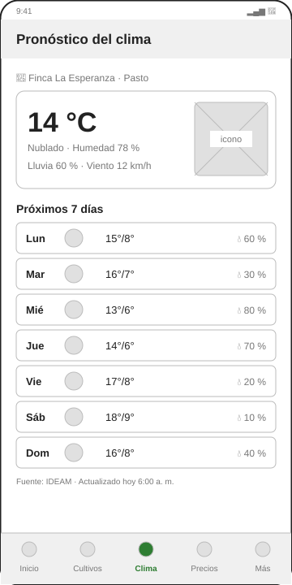

# Wireframes de AgroTec

Wireframes de baja fidelidad (vista móvil 360×720) en SVG. Cada historia de usuario enlaza al suyo.

| N.º | Pantalla | Historias |
|---|---|---|
| 01 | [Registro e inicio de sesión](01-registro-inicio-sesion.svg) | HU_001, HU_002, HU_025 |
| 02 | [Perfil y finca](02-perfil-finca.svg) | HU_003, HU_004 |
| 03 | [Inicio](03-inicio.svg) | HU_022, HU_023, HU_024 |
| 04 | [Mis cultivos](04-mis-cultivos.svg) | HU_006 |
| 05 | [Registrar cultivo](05-registrar-cultivo.svg) | HU_005 |
| 06 | [Actividades del cultivo](06-actividades-cultivo.svg) | HU_007, HU_008 |
| 07 | [Pronóstico del clima](07-pronostico-clima.svg) | HU_009, HU_026 |
| 08 | [Alertas de clima y plagas](08-alertas-clima-plagas.svg) | HU_010, HU_011 |
| 09 | [Precios del mercado](09-precios-mercado.svg) | HU_012, HU_013, HU_014 |
| 10 | [Sin conexión y sincronización](10-sin-conexion-sincronizacion.svg) | HU_015, HU_016, HU_017 |
| 11 | [Preferencias de notificaciones](11-notificaciones.svg) | HU_018 |
| 12 | [Capacitaciones](12-capacitaciones.svg) | HU_019 |
| 13 | [Soporte técnico](13-soporte-tecnico.svg) | HU_020 |
| 14 | [Planes y suscripción](14-planes-suscripcion.svg) | HU_021 |

### 01 · Registro e inicio de sesión

### 02 · Perfil y finca

### 03 · Inicio

### 04 · Mis cultivos

### 05 · Registrar cultivo

### 06 · Actividades del cultivo

### 07 · Pronóstico del clima

### 08 · Alertas de clima y plagas

### 09 · Precios del mercado

### 10 · Sin conexión y sincronización

### 11 · Preferencias de notificaciones

### 12 · Capacitaciones

### 13 · Soporte técnico

### 14 · Planes y suscripción

