# Wireframes de AgroTec

Wireframes de baja fidelidad (vista móvil 360×720) en SVG. Cada historia de usuario enlaza al suyo.

| N.º | Pantalla | Historias |
|---|---|---|
| 01 | [Registro e inicio de sesión](01-registro-inicio-sesion.svg) | HU-01, HU-02, HU-24 |
| 02 | [Perfil y finca](02-perfil-finca.svg) | HU-03, HU-25 |
| 03 | [Inicio](03-inicio.svg) | HU-20, HU-21, HU-23 |
| 04 | [Mis cultivos](04-mis-cultivos.svg) | HU-05 |
| 05 | [Registrar cultivo](05-registrar-cultivo.svg) | HU-04 |
| 06 | [Actividades del cultivo](06-actividades-cultivo.svg) | HU-06, HU-07 |
| 07 | [Pronóstico del clima](07-pronostico-clima.svg) | HU-08, HU-26 |
| 08 | [Alertas de clima y plagas](08-alertas-clima-plagas.svg) | HU-09, HU-10 |
| 09 | [Precios del mercado](09-precios-mercado.svg) | HU-11, HU-12, HU-13 |
| 10 | [Sin conexión y sincronización](10-sin-conexion-sincronizacion.svg) | HU-14, HU-15, HU-22 |
| 11 | [Preferencias de notificaciones](11-notificaciones.svg) | HU-16 |
| 12 | [Capacitaciones](12-capacitaciones.svg) | HU-17 |
| 13 | [Soporte técnico](13-soporte-tecnico.svg) | HU-18 |
| 14 | [Planes y suscripción](14-planes-suscripcion.svg) | HU-19 |

### 01 · Registro e inicio de sesión

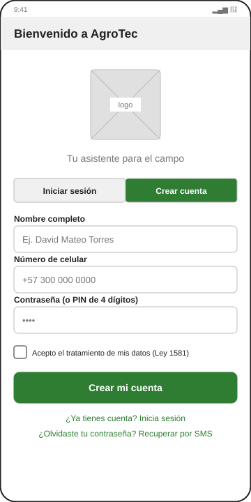

### 02 · Perfil y finca

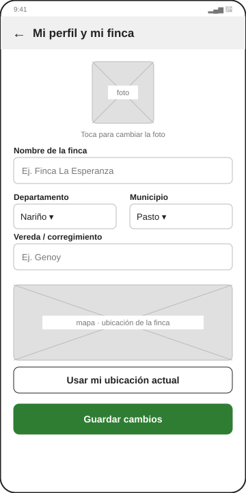

### 03 · Inicio

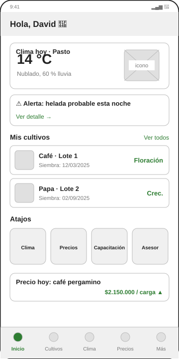

### 04 · Mis cultivos

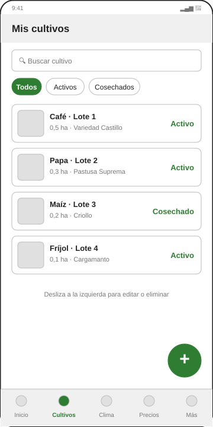

### 05 · Registrar cultivo

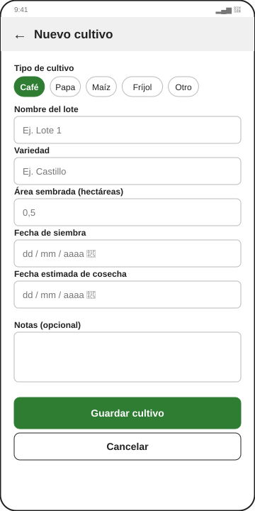

### 06 · Actividades del cultivo

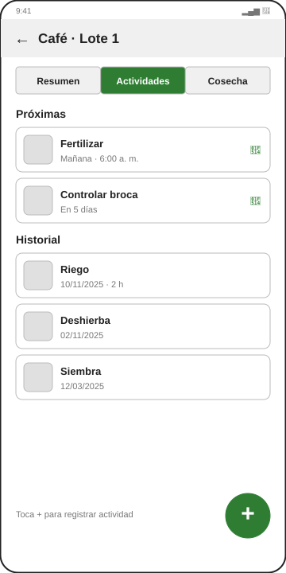

### 07 · Pronóstico del clima

### 08 · Alertas de clima y plagas

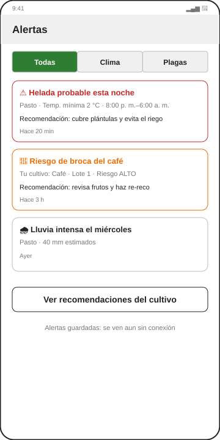

### 09 · Precios del mercado

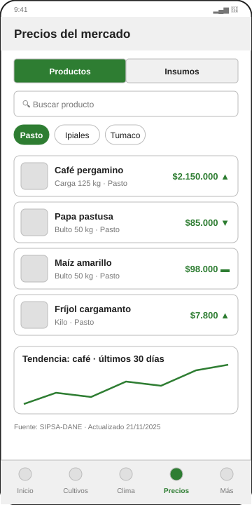

### 10 · Sin conexión y sincronización

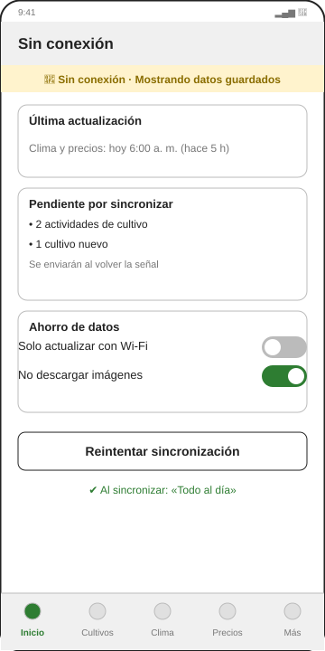

### 11 · Preferencias de notificaciones

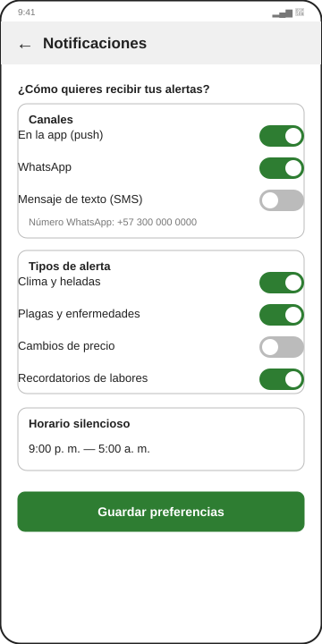

### 12 · Capacitaciones

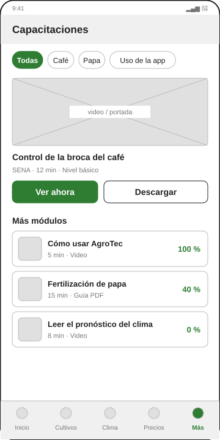

### 13 · Soporte técnico

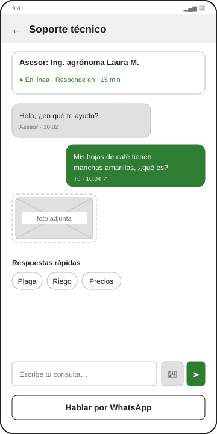

### 14 · Planes y suscripción

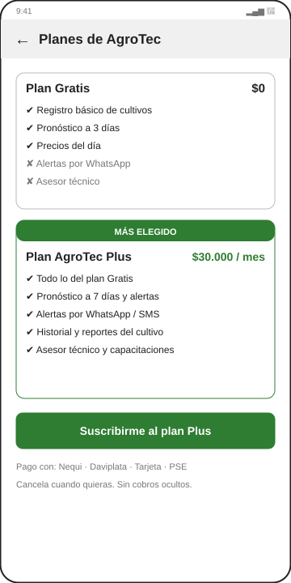
